# APACHE 2800 Portable IoT Demonstration System

**Engineering design document — version 3.6.1**

**Document status:** Active working design record

**Last updated:** 2026-09-04

### RP02 installation guides

Version 3.6.1 adds a browser-based electronics placement and wire-routing guide
plus a true-size US Letter rear drill template. The HTML records the fuse,
converter, floor-Pi, display-Pi and rear-control locations and separates the
12 V positive, negative-return, regulated 5 V and GPIO/control harnesses. It is
an installation plan, not an approved electrical schematic; switch pinout,
polarity, branch fuses, conductor sizing and the display/Pi 5 V topology remain
release gates.

The rear PDF is an outside view: XT60 left, master rocker center, dial right.
Its red 176 x 68 mm trim box is the estimated rear flat envelope from the
reference model. A 100 mm bar and 25 mm square detect printer scaling. The real
case recess, hinge/ribs, hardware, wire bends and lid clearance must pass a
paper/printed-carrier dry fit before cutting. Cutting does not preserve the
case's original environmental rating without sealing and testing.

### RP02 complete build revision

The [RP02 full build](full-build-RP02/README.md) supersedes RP01 for rear
placement and provides shell, integrated lower supports, tray, top-panel halves,
four module faceplates and the shared rear carrier together. The dial is included:
centers are X=-30 (dial), +10 (master rocker), +52 (XT60), all at Z45.
The 144 x 52 x 3 carrier includes the dial's anti-rotation hole; the rear shell
includes body and provisional wiring clearance for all three components.
See [RP02 analysis](full-build-RP02/FIT_ANALYSIS.md) for checks and limitations.
The tray retains RF02 perimeter dimensions, so prior binding is still an open
physical-fit issue. This is a complete CAD/export batch, not a passed fit test.
Previous source revisions remain intact and version-folder snapshots capture
the full dependency tree. See the changelog for the human-readable history.

### RP01 rear hardware revision (historical; rear layout superseded by RP02)

The [rear power study](analysis/rear-power/README.md) records the corrected physical
XT60 and rocker dimensions and creates a removable exterior carrier, fit
coupons and rear-shell clearance openings. This study supersedes the old
airflow model's unmeasured rear power placeholders for this hardware only.
Old airflow previews are not an up-to-date rear drilling reference.

The user reports the recessed fuse cavity looks good. Its geometry is retained,
but that feedback does not establish full shell, tray or wiring fit. The reported
upper-tray binding remains unresolved. New rear body passages stay 6.5 mm above
the tray, while carrier-nut relief leaves only 1.5 mm. No speculative tray
resizing or cutting was performed; verify this tighter fastener clearance.

Case wall thickness 1.0 mm is an estimate extracted from the approximate
vendored STEP at X=-48,0,+48 and source Z=30,42,47,60,70; ray crossings were
Y=116.5/117.5 on the positive-Y wall (the negative-Y wall also measured 1 mm).
The carrier's 3 mm switch seat must be coupon-tested. No physical case cut is
approved until exterior location, lid/hinge/ribs, inner alignment, fasteners and
terminal connectors are checked.

### Current distribution proposal and file history

The user chose to retain the existing fuse block and develop a recessed mount.
The [RF02 candidate](analysis/recessed-fuse/README.md) adds integrated lower support
ribs to four shell corners and a service opening in the upper tray. Its fuse
mounting plane is 6 mm above the floor, recovering 11.5 mm of vertical space.
The production Rev 5 files remain unchanged pending candidate fit validation.
The small distribution board has not been ordered. Do not mix the old tray
with the recessed mount; see the candidate's print-first list.

A plain distribution bus does not replace branch fuses. Candidate architecture:
external 12 V supply → XT60/master switch → protected positive distribution →
individually protected load branches, with a separate negative return bus.
Select protection from actual loads, wiring and connector ratings; the supply's
15 A rating is not a branch-fuse specification. Include insulation/cover,
terminal and wire-bend space, mounting holes, and service access in the next
measured envelope. A compact fused block is another option.
See [Blue Sea busbar descriptions](https://www.bluesea.com/products/category/18/busbars)
and [fuse-block functions](https://www.bluesea.com/products/5026/ST_Blade_Fuse_Block_-_12_Circuits_with_Negative_Bus_and_Cover).

Working files belong in C:\Code Projects\Copilot-IoT-Game\3d Models.
See [version-folder workflow](../VERSIONING.md) for source/export snapshots.

**Companion records:** [BOM.md](BOM.md) ·
[DESIGN_CHANGELOG.md](DESIGN_CHANGELOG.md)

## 1. Purpose

This document records the complete mechanical and thermal design process for a
portable IoT demonstration system installed in a Harbor Freight APACHE 2800
case. It explains what was designed, why each decision was made, what physical
tests changed the design, and what remains unverified.

The design consists of two related but deliberately separate models:

1. A removable, split, 3D-printed electronics chassis with a fixed modular
   control panel.
2. A planning model of the complete APACHE enclosure used to study airflow,
   heat, fan openings, low-voltage power entry, and a six-position control selector.
3. A split removable equipment tray that attaches through the printed chassis
   seam inserts without drilling the APACHE floor.

This is the authoritative narrative design record. The authoritative production
dimensions remain in `model_params.scad`. The airflow study includes those
production parameters and adds only case-reference, component-layout, port,
and thermal inputs in `analysis/airflow/airflow_params.scad`.

The enclosure was initially documented under the wrong APACHE 3800 product
name. On 2026-09-03 the user confirmed that the physical enclosure used for all
measurements and fit prints is an APACHE 2800. Existing measured insert geometry
therefore remains valid evidence from the actual case; it must not be rescaled
to catalogue dimensions. Harbor Freight catalogue values and the Bellafaire
APACHE 2800 FreeCAD/STEP model are reference envelopes only until individually
cross-checked against this case.

The catalogue's nominal 301.625 x 228.6 mm interior plan differs from the
physically fitted 306.3875 x 229.45 mm lower insert footprint by 4.7625 mm in
length and 0.85 mm in depth. This is not treated as a scaling error: catalogue
dimensions can describe a different elevation in the drafted cavity. The
measured contact profile and physical fit tests govern production geometry.

## 2. Design objectives

The system must:

- fit the actual molded floor of the APACHE 2800 without force or bowing;
- sit flat above the lower internal bevel rather than rocking on it;
- break into parts that fit a Bambu Lab X1 Carbon 256 x 256 x 256 mm build
  volume;
- provide a removable structural chassis with a large electronics cavity;
- mount floor electronics on removable, X1C-printable trays without piercing
  the waterproof enclosure floor;
- provide a rigid, removable, screw-fastened control deck with independently
  replaceable touchscreen and control modules;
- remove the lid foam and verify the newly exposed lid/rib clearance without
  placing heat-producing equipment outside the forced-air lower cavity;
- allow inexpensive fit testing before long production prints;
- move cooling air across the electronics rather than short-circuiting between
  adjacent vents;
- place user-accessible power and controls in the protected rear-center recess;
- preserve serviceability, electrical separation, strain relief, and guarded
  fan access; and
- distinguish measurements confirmed by a physical print from catalogue data,
  estimates, and placeholders.

## 3. Requirements and evidence status

| Item | Current value | Evidence class | Status |
|---|---:|---|---|
| Finished chassis width | 306.3875 mm / 12-1/16 in | Physical assembled fit test | Proven |
| Rev 5 lower footprint | 306.3875 x 229.45 mm through Z = 16 mm | Fully joined low-frame case fit | Proven |
| Rev 5 top footprint | 304.3875 x 226.45 mm at Z = 77 mm | Conservative relief after tight full-height print | Upper-frame physical test required |
| Production front span | 113.975 mm (`F 227.95`) | Corrected front pieces in joined frame | Proven |
| Production rear span | 115.475 mm (`R 230.95`) | Selected rear gauge in joined frame | Proven |
| Lower / top corner radius | 21.5 / 23.5 mm | Lower physically proven; top CAD correction | Top radius requires upper-frame test |
| Lower bevel height | 12 mm | Successful sample geometry | Validated profile |
| Lower bevel inset | 10 mm | Successful sample geometry | Validated profile |
| Bevel interpolation | Six-stage smoothstep | Successful sample geometry | Validated profile |
| Chassis height | 77 mm | Conservative retained geometry | Internal PSU removed; closed-lid clearance not yet proven |
| Case catalogue exterior | 419.1 x 330.2 x 171.45 mm | Manufacturer listing | Reference only |
| Case catalogue interior | 377.825 x 269.875 x 155.575 mm | Manufacturer listing | Reference only |
| Airflow heat load | 30 W | Placeholder analysis input | Measure after electronics selection |
| Allowed temperature rise | 10 C | Design target | Validate thermally |
| Fan format | Opposed 60 x 60 x 25 mm | Planning envelope | Exact fans not selected |
| Rear service-panel size | 176 x 68 mm estimated | Photo-derived envelope | Must be measured |
| Power inlet | External 12 V / 15 A supply, XT60 connector, and 12 V master switch | Selected architecture | Parts pending measurement; former C14/internal PSU retired |
| Control selector | FOCMKEAS RS26 2P6T, ASIN B0F9KTRGV5 | Direct caliper measurements | In hand; bushing, body, knob, depth, and anti-rotation pin promoted |
| DC distribution | Blue Sea Systems 5025, six circuits with negative bus | Direct caliper measurements | In hand; 124 x 84 x 40 mm envelope and 63 x 93 mm mounting pattern promoted |
| Branch conversion | Two PlusRoc USB-C and one Micro-USB converter | Direct caliper measurements | Three initially populated branches modeled; remaining fuse positions stay available |
| Panel architecture | Fixed 294.9875 x 217.05 x 5 mm split deck, ten chassis screws | Parametric CAD | Derived from relieved Rev 5 top footprint |
| Display/control modules | Measured original 7-inch Pi display; two safety toggles; two keys; two rockers; four activity sockets; four removable colored cables; four colored LEDs | Mixed: delivered connector measurements plus selected four-cable architecture | Four-socket candidate modeled; plug spacing, cable lengths, ID wiring, screen rear clamp, and terminal bends require tests |
| Equipment tray | Two 145.3 x 214 x 2 mm halves on eight existing seam bosses, with two cross-joiners | Parametric CAD candidate | Internal PSU removed; coupon, boss landing, screw stack, and vertical clearance require physical tests |

### Evidence hierarchy

When values conflict, use this order:

1. Fully joined physical fit test in the actual case.
2. Direct caliper or rigid-rule measurement of the actual case or component.
3. Manufacturer dimensional drawing.
4. Product-listing dimensions.
5. Catalogue enclosure dimensions.
6. Photo-derived estimates and CAD placeholders.

No lower class of evidence may silently overwrite a higher one.

### Bill of materials control

Every enclosure, fabricated assembly, mechanical component, electronic device,
cooling component, and electrical-safety item named by this design is tracked
in the [system bill of materials](BOM.md). BOM status distinguishes parts in
hand or ordered from planning envelopes and optional placeholders. Listing or
catalogue dimensions remain unverified until the delivered item is measured.

The BOM IDs provide stable references as selections mature. In particular,
`ELEC-001` is the ordered fused C14 inlet, `ELEC-002` is the ordered RS26
selector, `ELEC-010` is the selected Blue Sea 5025 DC fuse block, `ELEC-007`
is the selected PlusRoc converter family, `THM-001` and `THM-002` are the
unselected intake and exhaust fans. `MEC-001` records the retired hinge, while
`MEC-002` and `MEC-003` track the active heat-set inserts and M3 fasteners.

## 4. Development process

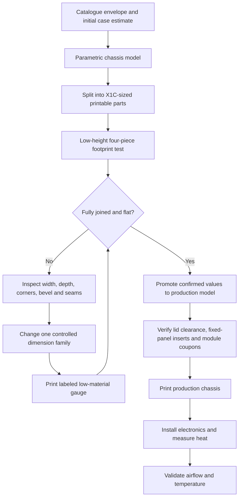

This loop deliberately separates calibration geometry from production
geometry. A candidate value is not promoted merely because an individual loose
piece appears to fit.

## 5. Mechanical design evolution

### 5.1 Initial parametric chassis

The initial model created an open-center perimeter chassis so the molded case
floor remains available for electronics. It included:

- upper and lower structural rails;
- a blank front bezel;
- a split moving control panel;
- continuous-hinge pockets and M3 heat-set insert bosses;
- gas-spring and actuator placeholder pads;
- a broad hinge-side cable route; and
- removable screw-fastened seam joiners.

Important dimensions were centralized in `model_params.scad`. This prevents
independent parts from drifting out of alignment when the footprint changes.

### 5.2 Printer-driven part splitting

The 306 mm-class chassis cannot fit on a 256 mm bed as one part. The chassis is
therefore split into four quadrants. The fixed panel is split into two halves,
each replaceable module fits separately, and joints use dedicated joiners
rather than permanent glue.

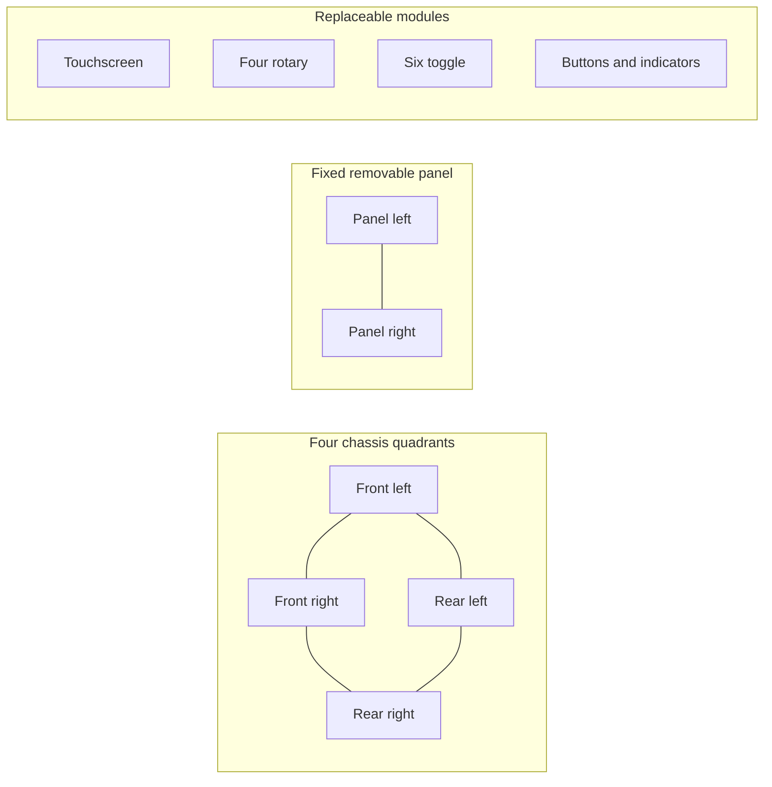

The current nominal maximum footprints remain below 256 x 256 mm, and the
OpenSCAD assertions plus Python STL validators provide two independent checks.
Slicer margins, brims, and plate exclusions must still be checked in Bambu
Studio.

### 5.3 Why the first footprint test was misleading

The first printed pieces looked generally correct but were too large and did
not sit consistently. Loose seams allowed the long rails to bow inward or
outward. Pressing the frame downward could make it appear to fit even though it
was storing elastic stress and sinking toward the center.

Design response:

- add push-pin joiners to lock all four test seams;
- evaluate only the fully assembled frame;
- label every part so mixed variants cannot be confused;
- separate width and depth corrections; and
- print only low-height interface geometry during calibration.

### 5.4 Lower bevel and corner response

The case floor transitions into the side wall through a rounded molded bevel.
A square-bottomed or simple straight-chamfer frame contacts the slope before it
reaches the flat floor.

The successful interface uses:

- 12 mm vertical bevel height;
- 10 mm horizontal inset;
- 21.5 mm corner radius in the final-fit frame; and
- six smoothstep-interpolated tapered slices.

For normalized height `t`, the inset interpolation is:

`inset(t) = bevel_inset x (1 - (3t^2 - 2t^3))`

The zero-slope ends make the transition visually and mechanically rounder than
a single linear frustum while remaining practical to generate in OpenSCAD.

### 5.5 Width and depth calibration

The width converged at 306.3875 mm. Depth remained too long even when the
overall nominal measurement appeared correct, most likely because the usable
floor is constrained by local corner transitions, draft, or molded features.

To avoid repeatedly printing a complete frame, a standalone one-side depth
gauge tested assembled depths of 232.95, 230.95, and 228.95 mm. Front and rear
halves were physically labeled, and a joiner locked the center seam.

The best observations were `F 228.95` and `R 230.95`. A subsequent complete
frame showed slight edge bowing, so only the front half was shortened another
1.0 mm overall. The successful final footprint is therefore:

`113.975 mm front + 115.475 mm rear = 229.45 mm assembled depth`

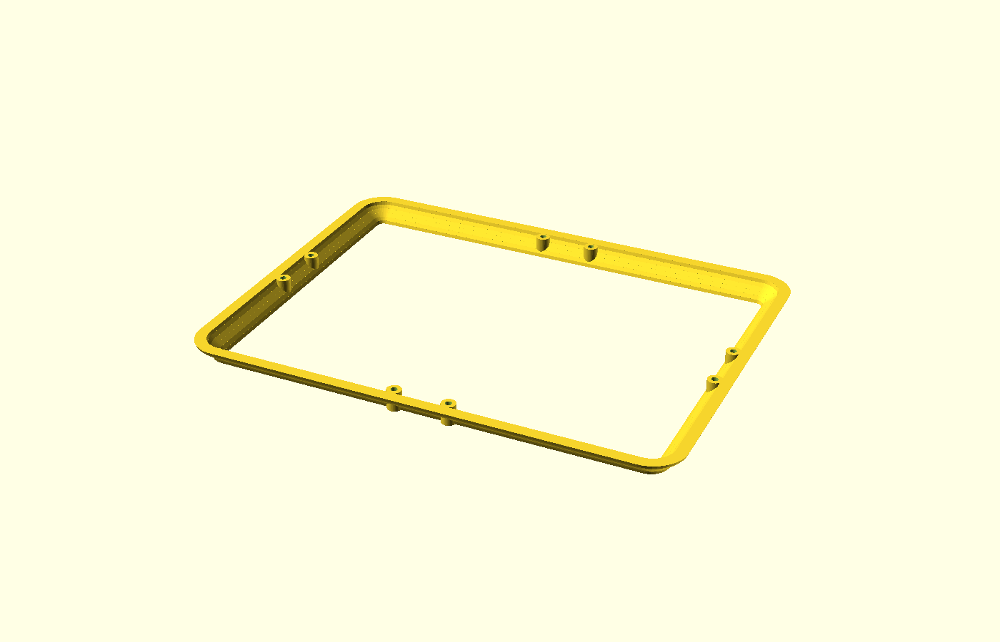

### 5.6 Production promotion result

The fully joined corrected low frame passed the physical case test and the user
confirmed that it worked well. Revision 4 therefore promoted 306.3875 x
229.45 mm into `model_params.scad`. The accepted low frame:

- sits flat without hand pressure;
- shows no visible edge bowing;
- does not spring upward when released;
- inserts and lifts out without force; and
- clears all four corners and local molded obstructions.

### 5.7 Full-height correction

The first 77 mm-high shell based on the passed lower outline was printable but
very tight in the actual case. This separates the evidence: the lower bevel and
footprint remain proven, while the upper wall, ribs, and corner transitions were
not exercised by the 16 mm frame. Revision 5 therefore leaves Z = 0–16 mm
unchanged and progressively relieves the shell above that height:

- 1.0 mm inward per side in width;
- 1.5 mm inward per side in depth; and
- 2.0 mm additional corner radius at the top.

The resulting top outline is 304.3875 x 226.45 mm with a 23.5 mm radius. A new
four-piece `upper_fit_*` frame reproduces that outline with only 10 mm of print
height. Support the joined gauge at the intended top-rail height in the case;
do not evaluate it on the narrower molded floor. This test distinguishes upper
length/radius interference before another complete shell is printed.

### 5.8 Third-party APACHE 2800 reference-model comparison

The MIT-licensed Bellafaire APACHE 2800 FreeCAD model and its open/closed STEP
assemblies are vendored under `references/apache-2800-cad-model/` at upstream
commit `03e16003008ad060749bf5ab678bf31af2ec339e`. An OpenCascade cross-section
analysis compares its lower case to the Rev 5 production profile at nine
heights; see [analysis/FIT_ANALYSIS.md](analysis/FIT_ANALYSIS.md).

The reference predicts no interference above Z = 16 mm and increasing Rev 5
clearance toward the panel rail. It instead predicts X-axis transition conflicts
at Z = 10 and 12 mm requiring roughly 0.67 and 0.50 mm relief per X side. Since
the physical 16 mm frame containing those heights passed, this disagreement is
evidence of the reference model's approximation, not authority to overwrite the
validated bevel. The result narrows the next diagnosis to print-induced wall
bow/seam preload, an unmodeled physical rib, or localized transition clearance.

## 6. Production chassis architecture

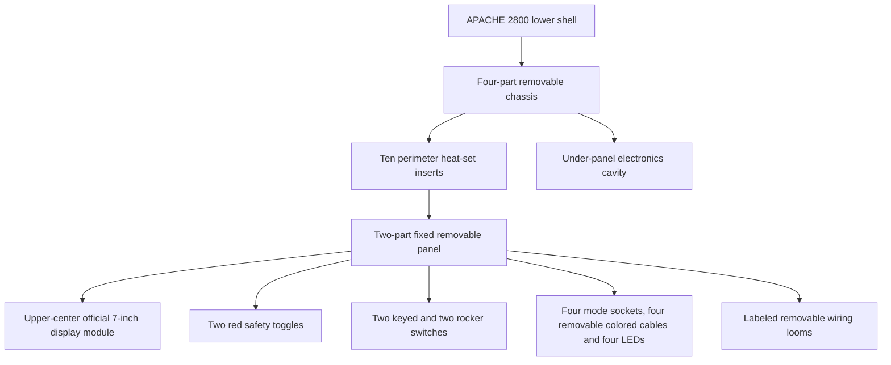

The open-center frame minimizes material and preserves access. Mechanical
service joints use screws and heat-set inserts instead of glue. The former
front bezel, piano hinge, gas-spring pads, actuator pads, hinge cable route, and
moving/service-angle assemblies are retired. Ten accessible perimeter screws
retain the deck. Removing those screws and disconnecting labeled harnesses
allows the complete panel to lift out for service.

The fixed base panel is split into X1C-printable left and right halves. Four
module plates sit over openings in the base:

- a 220 x 136 mm upper-center display carrier with a 157 x 89 mm viewing
  opening around the measured 155 x 87 mm illuminated area;
- a 90 x 74 mm lower-left plate for two measured red safety-cover toggles;
- a 90 x 74 mm lower-center plate for two keyed switches and two circular
  rocker switches; and
- a 90 x 74 mm lower-right plate for four four-pin mode sockets and four
  colored 5 mm LEDs. The red, blue, green, and orange cables are removable;
  there is no captive-cable opening.

Every module uses four screws into panel bosses. This lets a measured module
plate be reprinted without reprinting the structural deck. All control openings
use measured cutouts. The cable grommet, LED retention, terminal bends, and
screen rear support remain `MEASURE_BEFORE_PRINT` interfaces.
The centered screen and toggle plates cross the panel split and serve as two
widely separated seam bridges, so separate panel joiner bars are no longer part
of the active export set.

The four-cable activity uses loose, double-ended 152.4 mm (6 in) cables. Only
one contact is wired in each panel socket: socket 1 uses connector pin 1,
socket 2 uses pin 2, socket 3 uses pin 3, and socket 4 uses pin 4. Each cable
connects one pin on its end A to a different pin on its end B. The initial map
is red 1A-to-2B, blue 2A-to-3B, green 3A-to-4B, and orange 4A-to-1B.

Because the active pin differs at each cable end, installing A and B in the
wrong sockets or reversing the cable produces an open circuit. Both ends must
therefore carry durable color-plus-end markings such as `RED-A` and `RED-B`.
Heat-shrink labels are preferred for the first build; printed collars can be
designed after cable outside diameter is measured.

The controller scans the four socket channels as a connection matrix: leave
all channels as protected inputs, temporarily drive one channel through a
series resistor, read the other three, then return it to an input before the
next scan. With one plug allowed per socket, the system can identify up to two
simultaneous disjoint connections or no connection. Series resistors, defined
input pulls, GPIO voltage compatibility, ESD protection, and the final scan
schematic must be reviewed before wiring. These connectors must not carry
branch power.

Four sockets provide six electrically unique unordered pin pairs: 1-2, 1-3,
1-4, 2-3, 2-4, and 3-4. Therefore this scheme can support at most six cable
types without adding a resistor identity or another active conductor. Do not
create both 1A-to-2B and 2A-to-1B as separate cable types—the controller sees
the same closed pair after correct installation even though the A/B labels
enforce different physical orientations.

The candidate socket order is S1 upper-left, S2 upper-right, S3 lower-left,
and S4 lower-right. An LED sits immediately inward of each socket.
Software may illuminate only the sockets required by the active mode; an
unlit socket is expected to remain empty. This behavior is provisional until
the interaction is tested with users. Socket centers use a 44 mm horizontal and
36 mm vertical pitch. With the measured 17.81 mm plug diameter, this leaves
26.19 mm horizontally and 18.19 mm vertically between installed plug bodies.
Four-plug insertion and knurled-collar finger access still require a physical
module test.

The delivered screen is the original official 800 x 480 Touch Display with a
Pi 4B attached. It measures 193 x 110 mm across the glass, 155 x 87 mm across
the illuminated area, 6.04 mm for the display assembly, and 35 mm from the
front glass to the rearmost Pi hardware. It has no front mounting holes. The
module therefore acts as a front bezel and must be paired with a rear support
that does not load the glass or obstruct the Pi and display cables. The older
reference bezel STL measured 236 x 120 x 3 mm with a 169 x 104 mm opening and
a 220 x 60 mm four-hole pattern; those values are retained as design evidence,
not copied blindly into the smaller modular carrier.

The lid foam is removed. The exposed lid is treated first as clearance above
the screen, switches, and knobs—not as an assumed electronics bay. Powered
hardware placed in the lid would sit outside the lower side-to-side fan path and
would require a separate airflow, wiring-flex, retention, and lid-load analysis.
Until then, keep the lid volume empty or use only a shallow nonpowered holder
that clears the controls when the case closes.

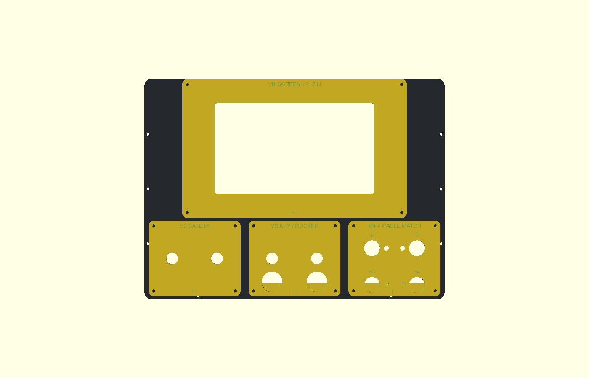

## 7. Complete case and airflow study

The airflow study is a separate non-production model. Its case shell is an
approximate reference envelope and its large STLs are explicitly named
`REFERENCE_DO_NOT_PRINT`.

The fixed panel and airflow study now derive from the same Rev 5 production
source: a 294.9875 x 217.05 mm deck at the relieved shell top. The passed
`calibration/case-fit/final-fit/` remains evidence for the lower interface, while the new
`upper_fit_*` parts validate the full-height correction.

### 7.1 Electronics envelopes

The revised mock layout includes planning blocks for BOM items `ELEC-005`,
`ELEC-007`, and `ELEC-010`:

- one measured Blue Sea 5025 fuse block, rotated to an 84 x 124 x 40 mm
  rear-left envelope;
- two measured USB-C converters and one measured Micro-USB converter in a
  single front-left service bank;
- one floor Pi 4B with direct GPIO terminal breakout, measured as an
  88.06 x 61.15 x 25.23 mm assembly; and
- the measured screen body and its attached Pi as separate rear keepouts.

The equipment tray top is 17.5 mm above the APACHE floor. Correcting the
airflow study to this installed elevation exposed a collision between the
floor Pi/GPIO assembly and the Pi attached behind the centered display. The
floor Pi is therefore located at X = +92 mm, Y = +38 mm on the right-hand tray
half. This leaves 5.47 mm hard-body X separation, or 3.47 mm after the model's
2 mm service-clearance allowance, from the screen-mounted Pi.

The fuse block replaces the former generic DC terminal-block mockup. The
external power supply is not installed on the tray. Named OpenSCAD positions feed
automatic rectangular-boundary and pairwise 2 mm hard-envelope checks. The
control list uses each measured rear body instead of one placeholder box per
module. Removing the internal PSU eliminates the former PSU/key-switch
collision and the need for the unproven 92 mm height candidate. The conservative
77 mm chassis remains subject to closed-lid and case split-line testing.

The checks prevent rectangular component collisions, but they do not
prove clearance at rounded case corners, connectors, fasteners, wire bends,
tool access, or service-removal paths.

### 7.2 Removable equipment tray

The revision 0.3 tray in `analysis/equipment-tray/` converts the measured electronics
layout into printable mounting geometry. A 291 x 214 x 2 mm ventilated plate is
split at the center into two 145.3 x 214 mm halves. Each half fits the X1
Carbon, and neither half requires a fastener through the APACHE floor.

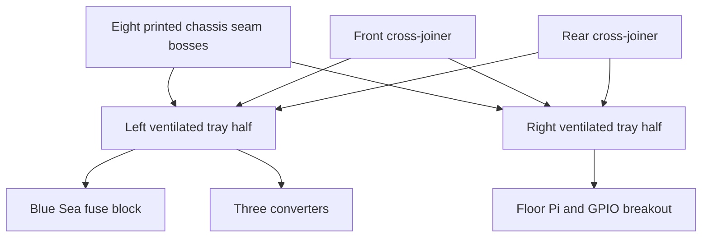

The fuse block is positioned at X = -91 mm to preserve clearance around the
compact tray fasteners while retaining the study's rectangular-envelope
spacing. The fuse, Pi, and converters use measured mounting patterns. The
external 12 V supply requires no tray mount or internal AC compartment.

The tray rests on the existing boss tops at Z = 15.5 mm; its top is Z = 17.5 mm.
The left and right halves replace the former side seam joiners, while two
50 x 14 x 4 mm bars join the halves at the front and rear center bosses. The
tray is therefore both the electronics carrier and part of the chassis seam
structure, while remaining removable without modifying the APACHE shell.

The approximate STEP case cavity clears this tray by at least 8.265 mm per X
side and 9.278 mm per Y side at the conservative Z = 16 mm section. The tighter
interface is the printed chassis lower-rail opening: its nominal clearance is
only 0.494 mm X and 0.525 mm Y per side. Tray-edge cleanup, elephant-foot
compensation, and a physical perimeter check are required before installing
electronics; the case reference does not justify altering the proven chassis.

Removing the internal PSU eliminates the former 12.86 mm PSU/key-switch
interference. Final screw lengths still depend on the real heat-set insert,
tray, cross-joiner, and washer stack. Print `fit_coupon.stl` and one
cross-joiner before either tray half, and perform a closed-lid witness test
before committing to the complete 77 mm-tall assembly.

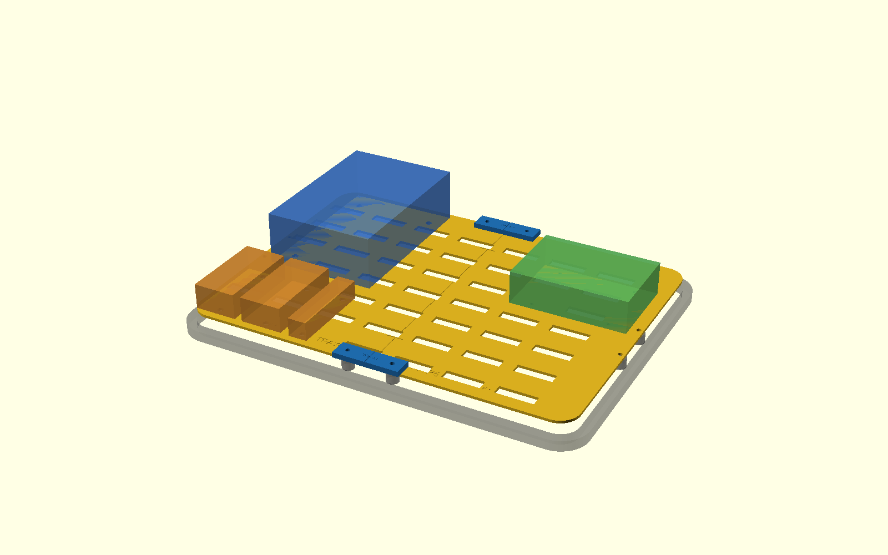

### 7.3 Airflow arrangement

The selected arrangement uses BOM item `THM-001`, a filtered intake on the left
short wall, and `THM-002`, an exhaust on the right short wall. The intake is
lower/front-biased and the exhaust is higher/rear-biased, producing a diagonal
sweep through the under-panel electronics volume.

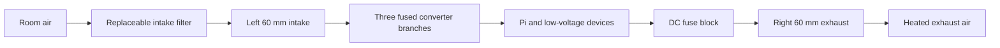

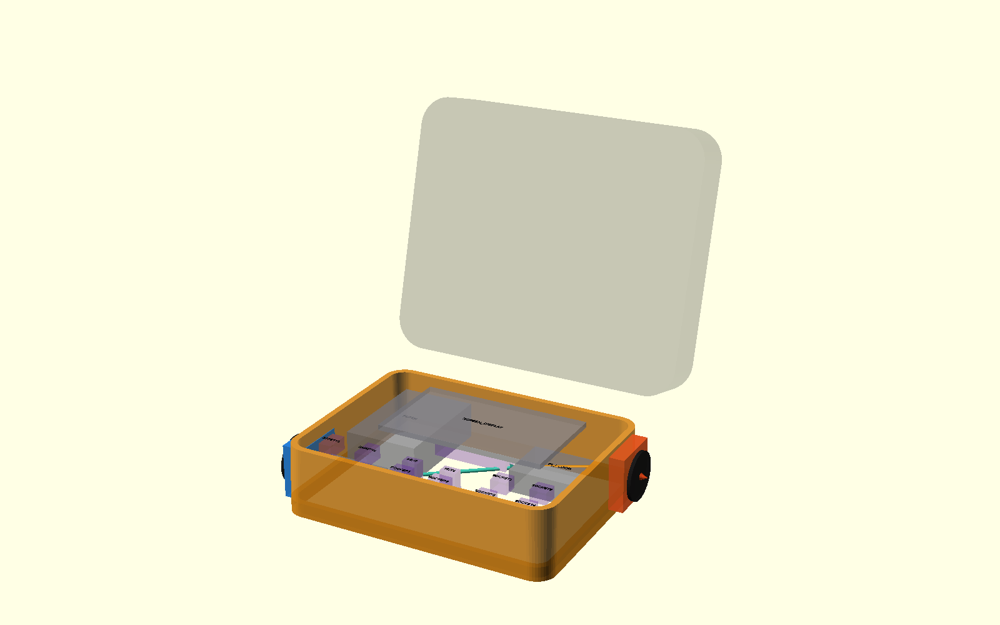

Placing intake and exhaust on opposite ends reduces direct recirculation.
Filters, guards, wall openings, wiring, and internal pressure loss will reduce
the fans' free-air rating. Two opposing fans in one path should not be treated
as having additive CFM; they primarily help overcome system resistance.

### 7.4 Preliminary thermal analysis

Near room conditions, approximately 1 CFM carries 0.569 W per degree Celsius.
The first-pass model uses:

- estimated internal loss: 30 W;
- allowed internal temperature rise: 10 C;
- safety factor: 1.75; and
- filter/grille delivery factor: 0.60.

The calculations are:

`ideal CFM = 30 / (0.569 x 10) = 5.27 CFM`

`design CFM = 5.27 x 1.75 = 9.23 CFM`

`required free-air rating = 9.23 / 0.60 = 15.38 CFM`

A nominal 20 CFM fan derates to approximately 12 CFM under the assumed factor,
which clears the preliminary 9.23 CFM target. This is not a thermal validation.
Three populated converters delivering their full 25 W outputs would provide
75 W total; at the provisional 90 percent efficiency assumption, converter
loss alone is approximately 8.3 W. That value does not include the external supply, computers,
display, fans, wiring, or other loads, so the present 30 W total heat input must
not be treated as a demonstrated worst case. The selected external supply must
also support the simultaneous branch load with appropriate margin.
The final test must use the closed case, actual filters and grilles, final wire
routing, maximum sustained compute load, and measured ambient and internal
temperatures.

## 8. Rear service panel

The exterior photograph identified a protected flat-looking recess between two
inner vertical ribs and below the hinge bar. The current study represents that
area as a 176 x 68 mm photo-derived planning envelope.

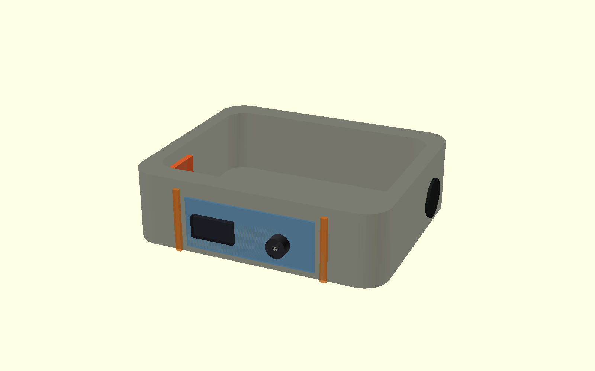

The power inlet is placed on the exterior-view left and the selector on the
right. Rotating the power module horizontally avoids consuming nearly the full
estimated panel height and improves clearance below the hinge.

### 8.1 Selected low-voltage power input

The selected architecture uses an external 12 V / 15 A supply, XT60 case
connector, and 12 V master switch. The former FILSHU C14 module and internal
metal AC/DC supply are retired. Exact cutouts, mounting patterns, rear depths,
terminal bends, polarity marking, sealing, and strain relief await receipt and
measurement of the new parts. No case drilling template is released yet.

### 8.2 Ordered six-position selector

The selected control, BOM item `ELEC-002`, is a FOCMKEAS RS26 2P6T rotary band
switch, Amazon ASIN `B0F9KTRGV5`.

| Feature | Current model |
|---|---:|
| Positions | 6 discrete positions |
| Main body/flange diameter | 27 mm |
| Rear collar diameter | 17.72 mm |
| Rear body depth | 16 mm |
| Panel hole | 9.27 mm |
| Knob diameter | 26.48 mm |
| Installed front projection | 21.55 mm |
| Anti-rotation pin | 2.96 mm diameter, 9.83 mm center offset, 4.67 mm projection |

This is a selector, not a continuous potentiometer. A suitable control scheme
is six low-current logic modes such as Off, Auto, Low, Medium, High, and Test.
Its listed 0.3 A contact rating makes it unsuitable for directly switching
mains power or high-current fans.

## 9. Electrical, thermal, and enclosure safety

The intended power architecture is:

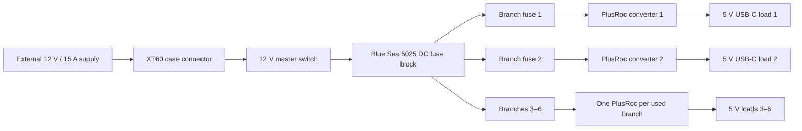

The Blue Sea 5025 is a maximum-32 V **DC** fuse block. Mains power must never
enter the APACHE case or be connected to it. The external supply's 12 V output
enters through the XT60 and master switch before feeding the fuse block.
Each populated branch receives an individually selected ATO/ATC fuse before
its converter. Fuse values must protect the converter, branch wiring, and
connectors—not merely match the fuse block's 30 A per-circuit maximum rating.

Cutting fan and connector openings invalidates the original enclosure rating
unless the finished system is independently sealed and tested. The design must
include:

- finger-safe fan guards on both sides where contact is possible;
- a serviceable intake filter and adequate free vent area;
- gasketed or sealed interfaces where environmental resistance is required;
- fused AC entry, protective earth where required, and strain relief;
- insulated mains terminals and physical segregation from low voltage;
- wire gauges and fusing sized for the actual load;
- guarded fuse replacement and switch access;
- no cable contact with fan blades, case-hinge hardware, or sharp cut edges;
  and
- review of the final mains implementation by a qualified person before use.

The rotary selector belongs on the isolated low-voltage control side. Fan power
should pass through a properly rated controller or driver.

## 10. Verification strategy

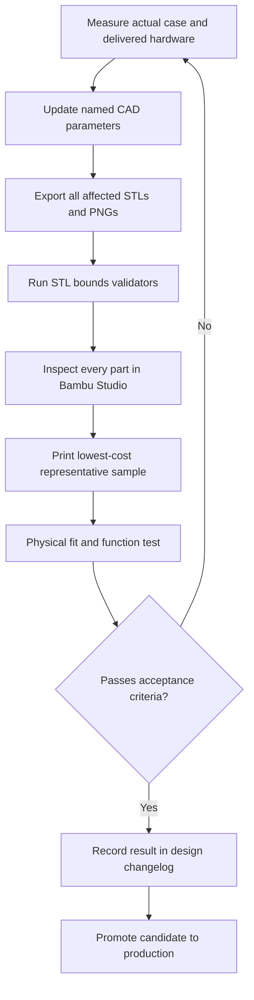

### 10.1 Mechanical acceptance tests

1. Join every fit-test seam completely.
2. Place the frame in the empty lower case without bending it.
3. Confirm continuous floor bearing and no rocking.
4. Confirm no visible rail bowing and no spring-back when released.
5. Confirm repeatable insertion and removal without force.
6. Check all ribs, corners, case hinge/latch structures, and removed-foam areas.
7. Verify chassis plus panel height using the closed lid.
8. Verify all ten panel screws engage inserts without pulling the split deck
   out of plane.
9. Lift the unscrewed panel using its intended service harness slack and verify
   that every connector can be reached without stressing wiring.

### 10.2 Port and hardware acceptance tests

1. Measure the rear recess width, height, wall thickness, rib boundaries, and
   distance to hinge hardware.
2. Measure the power module face, cutout body, retention features, corner
   radii, rear depth, and cable exit envelope.
3. Measure the selector bushing diameter, usable thread length, nut/washer,
   anti-rotation feature, body depth, terminal envelope, and knob.
4. Measure the 5025 overall envelope, mounting centers, terminal hardware,
   cover-removal space, and wire-bend/service envelope.
5. Measure a PlusRoc converter body, mounting ears, lead exits, lead lengths,
   and connector insertion/removal envelope.
6. Measure the touchscreen bezel, active area, body, mounting holes, connector
   positions, rear depth, and cable bend.
7. Measure every toggle, rotary, button, and indicator cutout, anti-rotation
   feature, nut/washer stack, rear depth, and terminal bend envelope.
8. Create and print thin labeled module/drill-template coupons.
9. Test the rear-panel components and control modules before modifying the case
   or printing the full structural panel.
10. Verify plug insertion/removal and knob use with the lid fully open.

### 10.3 Thermal acceptance tests

Record ambient temperature plus internal temperatures at the power supply,
compute devices, intake, and exhaust. Test at idle and worst sustained load with
the lid closed. Verify that the maximum temperature rise remains within the
selected limit and that fan noise, filter loading, and exhaust recirculation
are acceptable.

## 11. Measurement worksheet

Fill this table when the ordered parts arrive.

| Measurement | Result | Tool/method | Date | Promoted to CAD? |
|---|---:|---|---|---|
| Rear recess clear width | TBD | Calipers/rigid rule | — | No |
| Rear recess clear height | TBD | Calipers/rigid rule | — | No |
| Rear wall thickness | TBD | Calipers | — | No |
| C14 face width x height | 66.72 x 31.8 mm | Calipers | 2026-09-01 | Yes |
| C14 required cutout/body | 47.38 x 27.56 mm | Calipers/test coupon | 2026-09-01 | Yes |
| C14 rear depth | 16.62 mm plus unmeasured wire bend | Calipers/mock wiring | 2026-09-01 | Yes, hard body only |
| Selector bushing diameter | 9.27 mm | Calipers | 2026-09-01 | Yes |
| Selector usable thread length | TBD | Calipers | — | No |
| Selector rear body/terminal depth | 16 mm | Calipers | 2026-09-01 | Yes |
| Selector knob diameter/front projection | 26.48 / 21.55 mm | Calipers | 2026-09-01 | Yes |
| Blue Sea 5025 overall envelope | 124 x 84 x 40 mm | Calipers | 2026-09-01 | Yes |
| Blue Sea 5025 mounting centers | 63 x 93 mm; 4.78 mm holes | Calipers | 2026-09-01 | Yes |
| Blue Sea 5025 cover and wire service envelope | TBD | Physical mock wiring | — | No |
| PlusRoc converter ear-to-ear envelope | 63 x 32 x 19 mm; 52 mm slots | Calipers | 2026-09-01 | Yes |
| PlusRoc lead and USB-C service envelope | TBD | Physical mock wiring | — | No |
| Touchscreen visible area / glass | 155 x 87 / 193 x 110 mm | Calipers/template | 2026-09-01 | Yes |
| Touchscreen display / assembled rear depth | 6.04 / 35 mm | Calipers/mock wiring | 2026-09-01 | Yes, cable bend pending |
| Safety toggle cutout / rear depth | 11.62 / 14.46 mm | Calipers/coupon | 2026-09-01 | Yes |
| Key and rocker cutouts | 11.5 / 20.35 mm | Calipers/coupon | 2026-09-01 | Yes |
| LED and activity-socket interfaces | 5 / 15.6 mm | Calipers/coupon | 2026-09-01 | Yes, holders/grommet pending |
| Fixed-panel screw/insert pull-down test | TBD | Physical assembly | — | No |
| Final joined frame 306.3875 x 229.45 fit | Passed | Physical case test | 2026-09-02 | Yes |

## 12. Decision log

| ID | Decision | Rationale | Revisit trigger |
|---|---|---|---|
| D-001 | Use OpenSCAD with centralized named parameters | Repeatable regeneration and auditable dimensions | Change of CAD platform |
| D-002 | Split chassis into four quadrants | Required by 256 mm X1C bed | Larger printer or fundamentally smaller chassis |
| D-003 | Use removable mechanical joiners | Prevent seam movement during testing and preserve serviceability | Joint-strength failure |
| D-004 | Use low-height fit tests before production | Saves time and filament while reproducing the case interface | None; retain as standard process |
| D-005 | Use eased six-stage bevel | Successful flat seating against molded lower transition | New physical bevel evidence |
| D-006 | Calibrate width and depth independently | Case geometry and print error are not necessarily symmetric | New metrology showing uniform scale error |
| D-007 | Keep fit tests separate from production | Prevent unconfirmed values entering production geometry | Candidate passes full acceptance gate |
| D-008 | Use opposing side-wall fans | Long airflow path and reduced inlet/exhaust short circuit | Thermal or acoustic test failure |
| D-009 | Put power and selector in rear center recess | Protected, accessible surface away from side fans | Recess measurements or hinge conflict |
| D-010 | Mount the C14 module horizontally | Fits the low rear panel with better vertical margin | Delivered module or recess does not fit |
| D-011 | Use RS26 only as low-current selector | Six discrete modes; insufficient rating for direct power control | Controller architecture changes |
| D-012 | Use the Blue Sea 5025 for low-voltage branch distribution | Six fused positive branches and a negative bus match the six-mode/branch planning architecture | Measured space, current, or wiring tests fail |
| D-013 | Put one PlusRoc converter after each populated fuse-block branch | Provides per-load branch protection and local 5 V USB-C conversion | Fewer loads are installed or a centralized converter architecture proves preferable |
| D-014 | Retire the moving-panel mechanism | A fixed deck is simpler, more rigid, provides more control area, and removes hinge/strut/actuator clearance and failure modes | A later requirement demands frequent tool-free under-panel access |
| D-015 | Use four replaceable control modules | Exact controls can change without reprinting the full structural panel | A measured integrated commercial panel is selected |
| D-016 | Retain the fixed deck with ten perimeter screws | Distributed pull-down resists bowing while keeping the complete electronics bay serviceable | Insert pull-out, panel deflection, or access testing fails |
| D-017 | Use one unstacked front-left bank for two USB-C and one Micro-USB converter | Matches parts in hand, improves cooling and service access, and leaves three fuse circuits available | More branches are populated or wire routing rejects the bank |
| D-018 | Center the official 7-inch Pi display at the upper middle | Improves visibility and produces a symmetric console layout with controls below | Closed-lid, mounting, cable, or human-factors testing fails |
| D-019 | Use the centered screen and toggle plates as panel-seam bridges | Avoids joiner collisions inside the large centered display opening and reduces hardware | Module fastener or panel-deflection testing fails |
| D-020 | Retain a conservative 77 mm chassis height | Provides under-panel wiring and control-body room after the internal PSU was removed | Closed-lid or case split-line test fails |
| D-021 | Use four removable color-coded plugs/cables with four identical mode sockets | Allows software to require any cable-to-socket combination, any subset of cables, or no cables; electrical plug IDs distinguish wrong colors from simple occupancy | Connector wear, lost leads, accessibility, identification reliability, or low-voltage interface testing fails |
| D-022 | Promote the 306.3875 x 229.45 mm joined-frame result to production Rev 4 | The locked physical test fit the actual case without the earlier bowing problem | New repeatable physical evidence contradicts the result |
| D-023 | Use an external 12 V / 15 A supply through XT60 and a DC master switch | Removes mains and the bulky metal PSU from the case, resolves the tray/control collision, and simplifies service | Delivered parts, voltage-drop, current, thermal, or connector testing fails |
| D-024 | Preserve the passed lower 16 mm and relieve only the upper Rev 5 shell | The low frame fit but the full-height print was very tight, isolating the untested variable to upper wall/rib/corner clearance | Upper-frame test indicates a different width, depth, or radius correction |
| D-025 | Etch IDs, orientation marks, and paired seam witnesses into every printable assembly part | Prevents quadrant/version reversal and makes alignment visible during assembly | Marks reduce strength or are unreadable at the selected slicer settings |

## 13. Open risks and unresolved work

| Risk | Impact | Mitigation/status |
|---|---|---|
| Closed-lid height is unverified | Collision or inability to close | Depth-gauge or foam/clay witness test |
| Rev 5 upper relief is not physically verified | Full-height shell may remain tight or become unnecessarily loose | Print and test the labeled upper-clearance frame at top-rail height before reprinting the shell |
| Rear panel is photo-derived | Ports may hit ribs or double walls | Measure before any drilling template |
| Measured controls still lack printed coupons | Incorrect tolerance or retention despite correct nominal openings | Print thin labeled coupons before structural modules |
| Fan model and pressure curve unknown | Inadequate flow/noise | Select fan and test with actual filter/grille |
| Heat load is a placeholder | Thermal estimate may be wrong | Measure input/output losses at worst load |
| Converter leads and connector bends are not measured | Wires may collide despite measured hard bodies | Mock-wire all three converters before designing retainers |
| Fuse-block cover and terminal service clearance are unverified | Cover removal or safe wiring may be obstructed | Mock up the actual block, largest conductors, and tool access before mounting |
| XT60 and master-switch interfaces are unmeasured | Rear cutouts or terminals may not fit | Measure delivered parts and print drilling coupons before cutting the case |
| Fixed-panel inserts and module fasteners are untested | Panel could bow, loosen, or strip during service | Print insert coupon and perform repeated assembly/pull-down test |
| New 77 mm chassis height is not physically verified | Panel or tall controls may interfere with lid/ribs | Rigid depth-gauge or foam/clay witness test before full-height print |
| Screen rear-clamp geometry is not finalized | Screen could move or glass could be point-loaded | Design a broad rear support after recording Pi/cable offsets and print a screen-only fit coupon |
| Four removable cable lengths and storage are unresolved | Leads could be lost, snagged, or stored against controls | Select cable length, provide labeled storage, and perform insertion, pull, and transport-retention tests |

## 14. File map

| Path | Role |
|---|---|
| `model_params.scad` | Authoritative production mechanical parameters |
| `apache_2800_chassis.scad` | Production chassis, fixed modular panel, module plates, joints, and assemblies |
| `export_parts.ps1` | Production STL and preview export |
| `validate_stl_bounds.py` | X1C build-volume validation |
| `calibration/case-fit/length-fit/` | Standalone low-material depth gauges |
| `calibration/case-fit/final-fit/` | Passed four-quadrant 306.3875 x 229.45 mm Rev 4 evidence |
| `exports/stl/upper_fit_*.stl` | Rev 5 labeled upper-outline validation frame |
| `analysis/airflow/airflow_params.scad` | Case, hardware, and thermal study parameters |
| `analysis/airflow/apache_2800_airflow_study.scad` | Complete enclosure and airflow visualization |
| `analysis/airflow/estimate_airflow.py` | Repeatable preliminary airflow calculation |
| `analysis/airflow/exports/` | Visual evidence and non-printable reference envelopes |
| `references/apache-2800-cad-model/` | Vendored MIT-licensed FreeCAD and STEP reference model with source record |
| `analysis/apache_2800_fit_analysis.py` | Repeatable OpenCascade cross-section comparison |
| `analysis/FIT_ANALYSIS.md` | Reference-model fit results, limitations, and resulting design decision |
| `BOM.md` | Controlled purchased, planned, fabricated, safety, and test-item register |
| `DESIGN_CHANGELOG.md` | Human-maintained document and design-history record |

## 15. Document maintenance

Update this document whenever a measurement is confirmed, a candidate is
promoted, a component changes, an analysis assumption changes, or a test alters
the design. Add a matching entry to `DESIGN_CHANGELOG.md` in the same commit.
Git history remains useful, but it does not replace the explicit engineering
reason, evidence, and effect recorded in the changelog.
