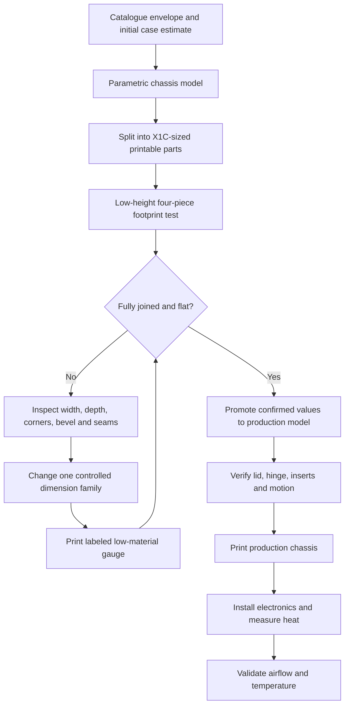
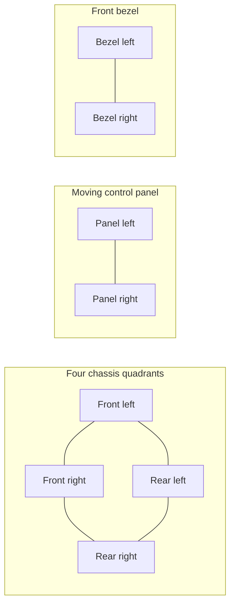
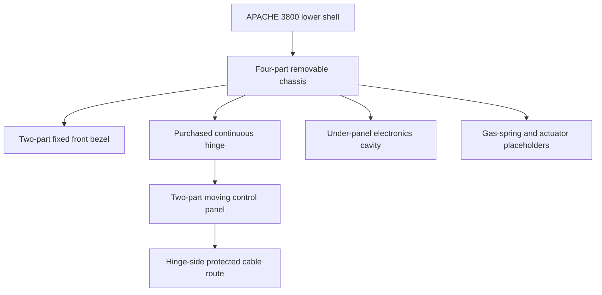
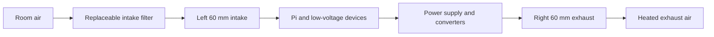
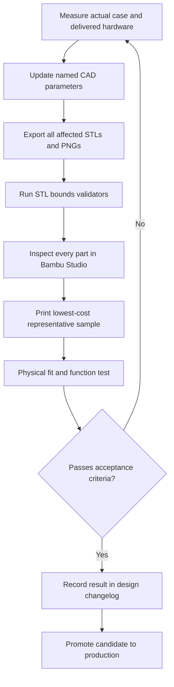

# APACHE 3800 Portable IoT Demonstration System

**Engineering design document — version 1.0.0**

**Document status:** Active working design record

**Last updated:** 2026-08-29

**Companion history:** [DESIGN_CHANGELOG.md](DESIGN_CHANGELOG.md)

## 1. Purpose

This document records the complete mechanical and thermal design process for a
portable IoT demonstration system installed in a Harbor Freight APACHE 3800
case. It explains what was designed, why each decision was made, what physical
tests changed the design, and what remains unverified.

The design consists of two related but deliberately separate models:

1. A removable, split, 3D-printed electronics chassis and moving control panel.
2. A planning model of the complete APACHE enclosure used to study airflow,
   heat, fan openings, AC power entry, and a six-position control selector.

This is the authoritative narrative design record. The authoritative production
dimensions remain in `model_params.scad`; the airflow-study inputs remain in
`case-airflow-study/airflow_params.scad`.

## 2. Design objectives

The system must:

- fit the actual molded floor of the APACHE 3800 without force or bowing;
- sit flat above the lower internal bevel rather than rocking on it;
- break into parts that fit a Bambu Lab X1 Carbon 256 x 256 x 256 mm build
  volume;
- provide a removable structural chassis with a large electronics cavity;
- support a hinged control surface and later gas-spring or actuator work;
- allow inexpensive fit testing before long production prints;
- move cooling air across the electronics rather than short-circuiting between
  adjacent vents;
- place user-accessible power and controls in the protected rear-center recess;
- preserve serviceability, electrical separation, strain relief, and guarded
  fan access; and
- distinguish measurements confirmed by a physical print from catalogue data,
  estimates, and placeholders.

## 3. Requirements and evidence status

| Item | Current value | Evidence class | Status |
|---|---:|---|---|
| Finished chassis width | 306.3875 mm / 12-1/16 in | Physical assembled fit test | Proven |
| Production Rev 3 depth | 234.95 mm / 9-1/4 in | Direct target measurement | Superseded by depth testing; still present in production source |
| Final-fit candidate depth | 229.45 mm | Labeled front/rear gauge selection | Awaiting final assembled-frame confirmation |
| Candidate front span | 113.975 mm (`F 227.95`) | Corrected front pieces | Awaiting final confirmation |
| Candidate rear span | 115.475 mm (`R 230.95`) | Best physical rear gauge | Selected candidate |
| Final-fit corner radius | 21.5 mm | Physical corner/bevel tests | Candidate carried into final frame |
| Lower bevel height | 12 mm | Successful sample geometry | Validated profile |
| Lower bevel inset | 10 mm | Successful sample geometry | Validated profile |
| Bevel interpolation | Six-stage smoothstep | Successful sample geometry | Validated profile |
| Chassis height | 70 mm | Design target | Closed-lid clearance not yet proven |
| Case catalogue exterior | 419.1 x 330.2 x 171.45 mm | Manufacturer listing | Reference only |
| Case catalogue interior | 377.825 x 269.875 x 155.575 mm | Manufacturer listing | Reference only |
| Airflow heat load | 30 W | Placeholder analysis input | Measure after electronics selection |
| Allowed temperature rise | 10 C | Design target | Validate thermally |
| Fan format | Opposed 60 x 60 x 25 mm | Planning envelope | Exact fans not selected |
| Rear service-panel size | 176 x 68 mm estimated | Photo-derived envelope | Must be measured |
| Power inlet | FILSHU C14/fuse/switch, ASIN B0FZQ866Z3 | Listing dimensions | Ordered; measure on arrival |
| Control selector | FOCMKEAS RS26 2P6T, ASIN B0F9KTRGV5 | Listing/common RS26 dimensions | Ordered; measure on arrival |

### Evidence hierarchy

When values conflict, use this order:

1. Fully joined physical fit test in the actual case.
2. Direct caliper or rigid-rule measurement of the actual case or component.
3. Manufacturer dimensional drawing.
4. Product-listing dimensions.
5. Catalogue enclosure dimensions.
6. Photo-derived estimates and CAD placeholders.

No lower class of evidence may silently overwrite a higher one.

## 4. Development process

This loop deliberately separates calibration geometry from production
geometry. A candidate value is not promoted merely because an individual loose
piece appears to fit.

## 5. Mechanical design evolution

### 5.1 Initial parametric chassis

The initial model created an open-center perimeter chassis so the molded case
floor remains available for electronics. It included:

- upper and lower structural rails;
- a blank front bezel;
- a split moving control panel;
- continuous-hinge pockets and M3 heat-set insert bosses;
- gas-spring and actuator placeholder pads;
- a broad hinge-side cable route; and
- removable screw-fastened seam joiners.

Important dimensions were centralized in `model_params.scad`. This prevents
independent parts from drifting out of alignment when the footprint changes.

### 5.2 Printer-driven part splitting

The 306 mm-class chassis cannot fit on a 256 mm bed as one part. The chassis is
therefore split into four quadrants. The panel and bezel are split into two
halves, and joints use dedicated joiners rather than permanent glue.

The current nominal maximum footprints remain below 256 x 256 mm, and the
OpenSCAD assertions plus Python STL validators provide two independent checks.
Slicer margins, brims, and plate exclusions must still be checked in Bambu
Studio.

### 5.3 Why the first footprint test was misleading

The first printed pieces looked generally correct but were too large and did
not sit consistently. Loose seams allowed the long rails to bow inward or
outward. Pressing the frame downward could make it appear to fit even though it
was storing elastic stress and sinking toward the center.

Design response:

- add push-pin joiners to lock all four test seams;
- evaluate only the fully assembled frame;
- label every part so mixed variants cannot be confused;
- separate width and depth corrections; and
- print only low-height interface geometry during calibration.

### 5.4 Lower bevel and corner response

The case floor transitions into the side wall through a rounded molded bevel.
A square-bottomed or simple straight-chamfer frame contacts the slope before it
reaches the flat floor.

The successful interface uses:

- 12 mm vertical bevel height;
- 10 mm horizontal inset;
- 21.5 mm corner radius in the final-fit frame; and
- six smoothstep-interpolated tapered slices.

For normalized height `t`, the inset interpolation is:

`inset(t) = bevel_inset x (1 - (3t^2 - 2t^3))`

The zero-slope ends make the transition visually and mechanically rounder than
a single linear frustum while remaining practical to generate in OpenSCAD.

### 5.5 Width and depth calibration

The width converged at 306.3875 mm. Depth remained too long even when the
overall nominal measurement appeared correct, most likely because the usable
floor is constrained by local corner transitions, draft, or molded features.

To avoid repeatedly printing a complete frame, a standalone one-side depth
gauge tested assembled depths of 232.95, 230.95, and 228.95 mm. Front and rear
halves were physically labeled, and a joiner locked the center seam.

The best observations were `F 228.95` and `R 230.95`. A subsequent complete
frame showed slight edge bowing, so only the front half was shortened another
1.0 mm overall. The current final-fit candidate is therefore:

`113.975 mm front + 115.475 mm rear = 229.45 mm assembled depth`

### 5.6 Production promotion gate

The production file intentionally remains Rev 3 at 306.3875 x 234.95 mm. The
229.45 mm candidate must not be copied into `model_params.scad` until the fully
joined corrected final-fit frame:

- sits flat without hand pressure;
- shows no visible edge bowing;
- does not spring upward when released;
- inserts and lifts out without force; and
- clears all four corners and local molded obstructions.

## 6. Production chassis architecture

The open-center frame minimizes material and preserves access. Mechanical
service joints use screws and heat-set inserts instead of glue. Hinge, insert,
gas-spring, and actuator values remain placeholders until the exact hardware is
measured and motion is checked through both the 30-degree operating angle and
80-degree service angle.

## 7. Complete case and airflow study

The airflow study is a separate non-production model. Its case shell is an
approximate reference envelope and its large STLs are explicitly named
`REFERENCE_DO_NOT_PRINT`.

### 7.1 Electronics envelopes

The present mock layout includes planning blocks for:

- one 159 x 97 x 30 mm power supply;
- two 85 x 56 x 22 mm Raspberry Pi-class devices;
- one 52 x 32 x 18 mm DC converter; and
- one 90 x 24 x 22 mm terminal/distribution block.

These blocks study congestion and airflow only. Hole patterns, connector
locations, cable bend radii, and service-removal paths are not yet designed.

### 7.2 Airflow arrangement

The selected arrangement uses a filtered intake on the left short wall and an
exhaust on the right short wall. The intake is lower/front-biased and the
exhaust is higher/rear-biased, producing a diagonal sweep through the
under-panel electronics volume.

Placing intake and exhaust on opposite ends reduces direct recirculation.
Filters, guards, wall openings, wiring, and internal pressure loss will reduce
the fans' free-air rating. Two opposing fans in one path should not be treated
as having additive CFM; they primarily help overcome system resistance.

### 7.3 Preliminary thermal analysis

Near room conditions, approximately 1 CFM carries 0.569 W per degree Celsius.
The first-pass model uses:

- estimated internal loss: 30 W;
- allowed internal temperature rise: 10 C;
- safety factor: 1.75; and
- filter/grille delivery factor: 0.60.

The calculations are:

`ideal CFM = 30 / (0.569 x 10) = 5.27 CFM`

`design CFM = 5.27 x 1.75 = 9.23 CFM`

`required free-air rating = 9.23 / 0.60 = 15.38 CFM`

A nominal 20 CFM fan derates to approximately 12 CFM under the assumed factor,
which clears the preliminary 9.23 CFM target. This is not a thermal validation.
The final test must use the closed case, actual filters and grilles, final wire
routing, maximum sustained compute load, and measured ambient and internal
temperatures.

## 8. Rear service panel

The exterior photograph identified a protected flat-looking recess between two
inner vertical ribs and below the hinge bar. The current study represents that
area as a 176 x 68 mm photo-derived planning envelope.

The power inlet is placed on the exterior-view left and the selector on the
right. Rotating the power module horizontally avoids consuming nearly the full
estimated panel height and improves clearance below the hinge.

### 8.1 Ordered power inlet

The selected part is a FILSHU IEC320 C14 inlet module with a fuse holder,
rocker switch, and preattached leads, Amazon ASIN `B0FZQ866Z3`.

Listing/drawing values currently modeled:

| Feature | Modeled value |
|---|---:|
| Face, horizontal orientation | 66.6 x 31.8 mm |
| Panel cutout | 56.1 x 27.9 mm |
| Rear body allowance | 30 mm |

These are not drilling dimensions until the delivered flange, snap body,
corner radii, fastener features, fuse access, terminals, and wire bend space
are measured.

### 8.2 Ordered six-position selector

The selected control is a FOCMKEAS RS26 2P6T rotary band switch, Amazon ASIN
`B0F9KTRGV5`.

| Feature | Current model |
|---|---:|
| Positions | 6 discrete positions |
| Body diameter | 28.6 mm |
| Shaft | 6 mm diameter x 20 mm long |
| Total listed height | 38 mm |
| Inferred rear body depth | 18 mm |
| Provisional panel hole | 9.8 mm |
| Placeholder knob | 18 mm diameter x 14 mm deep |

This is a selector, not a continuous potentiometer. A suitable control scheme
is six low-current logic modes such as Off, Auto, Low, Medium, High, and Test.
Its listed 0.3 A contact rating makes it unsuitable for directly switching
mains power or high-current fans.

## 9. Electrical, thermal, and enclosure safety

Cutting fan and connector openings invalidates the original enclosure rating
unless the finished system is independently sealed and tested. The design must
include:

- finger-safe fan guards on both sides where contact is possible;
- a serviceable intake filter and adequate free vent area;
- gasketed or sealed interfaces where environmental resistance is required;
- fused AC entry, protective earth where required, and strain relief;
- insulated mains terminals and physical segregation from low voltage;
- wire gauges and fusing sized for the actual load;
- guarded fuse replacement and switch access;
- no cable contact with fan blades, hinge motion, or sharp cut edges; and
- review of the final mains implementation by a qualified person before use.

The rotary selector belongs on the isolated low-voltage control side. Fan power
should pass through a properly rated controller or driver.

## 10. Verification strategy

### 10.1 Mechanical acceptance tests

1. Join every fit-test seam completely.
2. Place the frame in the empty lower case without bending it.
3. Confirm continuous floor bearing and no rocking.
4. Confirm no visible rail bowing and no spring-back when released.
5. Confirm repeatable insertion and removal without force.
6. Check all ribs, corners, hinge/latch structures, and the retained foam.
7. Verify chassis plus panel height using the closed lid.
8. Test the actual hinge and heat-set inserts with the hardware coupon.

### 10.2 Port and hardware acceptance tests

1. Measure the rear recess width, height, wall thickness, rib boundaries, and
   distance to hinge hardware.
2. Measure the power module face, cutout body, retention features, corner
   radii, rear depth, and cable exit envelope.
3. Measure the selector bushing diameter, usable thread length, nut/washer,
   anti-rotation feature, body depth, terminal envelope, and knob.
4. Create and print a thin, labeled rear-panel drill-template coupon.
5. Test both components in the coupon before modifying the case.
6. Verify plug insertion/removal and knob use with the lid fully open.

### 10.3 Thermal acceptance tests

Record ambient temperature plus internal temperatures at the power supply,
compute devices, intake, and exhaust. Test at idle and worst sustained load with
the lid closed. Verify that the maximum temperature rise remains within the
selected limit and that fan noise, filter loading, and exhaust recirculation
are acceptable.

## 11. Measurement worksheet

Fill this table when the ordered parts arrive.

| Measurement | Result | Tool/method | Date | Promoted to CAD? |
|---|---:|---|---|---|
| Rear recess clear width | TBD | Calipers/rigid rule | — | No |
| Rear recess clear height | TBD | Calipers/rigid rule | — | No |
| Rear wall thickness | TBD | Calipers | — | No |
| C14 face width x height | TBD | Calipers | — | No |
| C14 required cutout | TBD | Calipers/test coupon | — | No |
| C14 rear depth and cable bend | TBD | Calipers/mock wiring | — | No |
| Selector bushing diameter | TBD | Calipers | — | No |
| Selector usable thread length | TBD | Calipers | — | No |
| Selector rear body/terminal depth | TBD | Calipers | — | No |
| Selector knob diameter/depth | TBD | Calipers | — | No |
| Final joined frame 306.3875 x 229.45 fit | TBD | Physical case test | — | No |

## 12. Decision log

| ID | Decision | Rationale | Revisit trigger |
|---|---|---|---|
| D-001 | Use OpenSCAD with centralized named parameters | Repeatable regeneration and auditable dimensions | Change of CAD platform |
| D-002 | Split chassis into four quadrants | Required by 256 mm X1C bed | Larger printer or fundamentally smaller chassis |
| D-003 | Use removable mechanical joiners | Prevent seam movement during testing and preserve serviceability | Joint-strength failure |
| D-004 | Use low-height fit tests before production | Saves time and filament while reproducing the case interface | None; retain as standard process |
| D-005 | Use eased six-stage bevel | Successful flat seating against molded lower transition | New physical bevel evidence |
| D-006 | Calibrate width and depth independently | Case geometry and print error are not necessarily symmetric | New metrology showing uniform scale error |
| D-007 | Keep fit tests separate from production | Prevent unconfirmed values entering production geometry | Candidate passes full acceptance gate |
| D-008 | Use opposing side-wall fans | Long airflow path and reduced inlet/exhaust short circuit | Thermal or acoustic test failure |
| D-009 | Put power and selector in rear center recess | Protected, accessible surface away from side fans | Recess measurements or hinge conflict |
| D-010 | Mount the C14 module horizontally | Fits the low rear panel with better vertical margin | Delivered module or recess does not fit |
| D-011 | Use RS26 only as low-current selector | Six discrete modes; insufficient rating for direct power control | Controller architecture changes |

## 13. Open risks and unresolved work

| Risk | Impact | Mitigation/status |
|---|---|---|
| Final 229.45 mm frame has not been explicitly confirmed | Production chassis may still bow or bind | Complete joined-frame test before Rev 4 |
| Closed-lid height is unverified | Collision or inability to close | Depth-gauge or foam/clay witness test |
| Rear panel is photo-derived | Ports may hit ribs or double walls | Measure before any drilling template |
| Ordered component dimensions may differ from listings | Incorrect openings or retention | Caliper measurement and coupon |
| Fan model and pressure curve unknown | Inadequate flow/noise | Select fan and test with actual filter/grille |
| Heat load is a placeholder | Thermal estimate may be wrong | Measure input/output losses at worst load |
| Mains wiring design incomplete | Shock/fire hazard | Qualified review, protection, segregation |
| Hinge and inserts unmeasured | Weak or misaligned moving panel | Hardware coupon and motion test |
| Gas-spring/actuator pads are placeholders | Excess force or collision | Dedicated linkage analysis before purchase |

## 14. File map

| Path | Role |
|---|---|
| `model_params.scad` | Authoritative production mechanical parameters |
| `apache_3800_chassis.scad` | Production chassis, panel, bezel, joints, and assemblies |
| `export_parts.ps1` | Production STL and preview export |
| `validate_stl_bounds.py` | X1C build-volume validation |
| `length-fit-test/` | Standalone low-material depth gauges |
| `final-fit-test/` | Current four-quadrant 306.3875 x 229.45 mm candidate |
| `case-airflow-study/airflow_params.scad` | Case, hardware, and thermal study parameters |
| `case-airflow-study/apache_3800_airflow_study.scad` | Complete enclosure and airflow visualization |
| `case-airflow-study/estimate_airflow.py` | Repeatable preliminary airflow calculation |
| `case-airflow-study/exports/` | Visual evidence and non-printable reference envelopes |
| `DESIGN_CHANGELOG.md` | Human-maintained document and design-history record |

## 15. Document maintenance

Update this document whenever a measurement is confirmed, a candidate is
promoted, a component changes, an analysis assumption changes, or a test alters
the design. Add a matching entry to `DESIGN_CHANGELOG.md` in the same commit.
Git history remains useful, but it does not replace the explicit engineering
reason, evidence, and effect recorded in the changelog.
