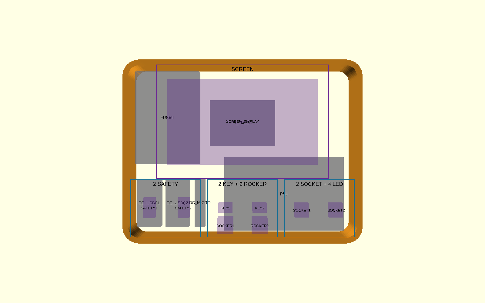

# APACHE 3800 case and airflow study

See [the complete engineering design document](../DESIGN_DOCUMENT.md) for the
mechanical history, airflow analysis, decision log, risks, and validation plan.
All purchased, selected, and required mechanical, electrical, and cooling
components are tracked in [the system bill of materials](../BOM.md).
Document revisions are recorded in
[the design changelog](../DESIGN_CHANGELOG.md).

This is a separate planning model for the complete APACHE 3800 enclosure. It
does not modify the production chassis and is not a drilling template.

The model combines Harbor Freight's approximate catalogue envelope with the
physically tested chassis footprint. It provides visible keepouts and proposed
locations for cooling, rear-wall AC power entry, and a rear control dial.

## Baseline geometry

Harbor Freight lists the APACHE 3800 at approximately:

- Exterior: 16-1/2 x 13 x 6-3/4 inches
- Interior: 14-7/8 x 10-5/8 x 6-1/8 inches
- Polypropylene construction with an IP65 rating

Source: <https://www.harborfreight.com/3800-weatherproof-protective-case-16-516-in-63927.html>

The study imports the current 306.3875 x 234.95 x 77 mm production chassis
from `../model_params.scad` and places it inside a tapered lower cavity. The
separate 229.45 mm final-fit candidate is not used here. The exact case split,
floor size, draft, ribs, hinge,
latches, handle, and flat exterior wall areas remain `MEASURE_BEFORE_DRILL`
parameters.

## Recommended first-pass port layout

| Function | Proposed location | Placeholder interface |
|---|---|---|
| Filtered intake | Left short end, front/lower offset | 60 mm fan, 54 mm opening, 50 mm hole pitch |
| Exhaust | Right short end, rear/upper offset | 60 mm fan, 54 mm opening, 50 mm hole pitch |
| Fused AC inlet | Left side of the recessed rear-center panel shown in the reference photo | In-hand FILSHU C14/fuse/switch module; measured 47.38 x 27.56 mm body/cutout, 66.72 x 31.8 mm face, 16.62 mm rear depth, and two 2.99 mm holes on 55.09 mm pitch |
| Six-position control selector | Right side of the same recessed rear-center panel | In-hand FOCMKEAS RS26 2P6T; measured 9.27 mm panel hole, 27 mm body/flange, 16 mm rear depth, 21.55 mm front projection, and anti-rotation pin |

This diagonal low-to-high path crosses the under-panel electronics cavity. The
fans stay on the unobstructed left/right ends, while power and the dial share
the protected rectangular panel between the two inner rear ribs and below the
hinges. The blue area and orange rib guides in `rear_port_layout.png` are a
photo-derived planning envelope, not measured geometry. Confirm that this area
is flat and single-wall, and that cords and the knob
clear the opened lid, hinge hardware, table, and adjacent equipment.

The power inlet represents the in-hand FILSHU IEC320 C14 inlet, fuse holder,
and rocker-switch module from Amazon ASIN `B0FZQ866Z3`. It is rotated 90 degrees
so its measured 66.72 x 31.8 mm face fits within the low rear panel. The model
uses the measured 47.38 x 27.56 mm body/cutout, 16.62 mm rear depth, and two
2.99 mm mounting holes on 55.09 mm pitch. Corner radii, terminal bend, wall
thickness, and sealing still require a drilling coupon and case measurement.

Product reference: <https://www.amazon.com/dp/B0FZQ866Z3?th=1>

The control is the in-hand FOCMKEAS RS26 2P6T rotary band switch from Amazon
ASIN `B0F9KTRGV5`. It is a six-position selector, not a continuously variable
potentiometer. The model uses the measured 9.27 mm panel hole, 17.72 mm collar,
27 mm body/flange, 16 mm rear depth, 21.55 mm front projection, and 26.48 mm
knob. Its 2.96 mm anti-rotation pin is 9.83 mm from the shaft center and projects
4.67 mm.

Use this switch as a low-current selector input for six controller modes, not
as a mains-power switch or direct high-current fan control. Confirm the actual
bushing diameter and usable threaded length, anti-rotation hardware, terminal
clearance, knob dimensions, and case-wall thickness before making a drilling
template or adapter plate.

Product reference: <https://www.amazon.com/dp/B0F9KTRGV5?th=1>

## DC distribution and revised component layout

The selected low-voltage distribution part is the Blue Sea Systems 5025 ST
Blade Fuse Block with negative bus, Amazon ASIN `B000THQ0CQ`. It provides six
ATO/ATC fused circuits and is rated by the manufacturer for 32 V DC maximum,
100 A maximum for the block, and 30 A maximum per circuit. Its manufacturer
drawing gives a 124.31 x 84.20 x 38.57 mm overall envelope, 98.58 x 63.50 mm
mounting centers, and M4/#8 mounting holes.

Manufacturer reference: <https://www.bluesea.com/products/5025/ST_Blade_Fuse_Block>

Amazon reference: <https://www.amazon.com/dp/B000THQ0CQ>

Two fused branches feed PlusRoc `PR4A070` waterproof USB-C buck
converter, Amazon ASIN `B0FD735LFG`. The listing specifies 8–32 V DC input and
5 V/5 A, 25 W maximum USB-C output. Each measured body is 46 x 32 x 19 mm,
63 mm overall across its tabs, with mounting slots on 52 mm pitch. A third
fused branch feeds the measured Micro-USB converter, whose body is 47 x 14 x
14 mm and 64 mm overall across its tabs. The study shows exactly these three
in-hand converters in a front-left service bank.

Product reference: <https://www.amazon.com/dp/B0FD735LFG>

The safe functional order is:

`C14 AC inlet -> AC/DC supply -> 12/24 V DC -> Blue Sea 5025 -> branch fuse -> PlusRoc converter -> 5 V USB-C load`

The 5025 is DC-only and must never receive mains voltage. Each branch fuse must
be selected for its converter, conductor, connector, and load; 30 A is the
fuse block's circuit limit, not the correct converter fuse value.

The collision-checked study layout places the rotated fuse block at the rear
left, the power supply toward the front-right, all three converters in a
front-left service bank, and the separate Pi 4B/GPIO-breakout assembly near
the center. The screen-mounted Pi is modeled with the display. The
old generic terminal-block envelope is removed because
the 5025 now provides the DC positive distribution and negative bus. Any mains
terminal/barrier hardware remains a separate selection.

OpenSCAD assertions now check that all rectangular component envelopes stay
inside the nominal chassis-rail boundary and retain at least 2 mm pairwise
clearance. These checks do not include rounded-corner detail, mounting
fasteners, connector access, wiring bend radius, cover removal, or a component
service path, so the delivered hardware still requires a physical mockup.

The control deck is fixed and removable rather than hinged. A 220 x 146 mm
carrier centers the measured 193 x 110 mm original Raspberry Pi 7-inch display
with its attached Pi 4B and 35 mm total depth. Three 90 x 74 mm lower modules
hold two safety toggles; two key switches plus two circular rockers; and two
mode sockets plus four bare LEDs. The 77 mm chassis height clears the measured
rear control bodies in the proposed layout, but closed-lid height still needs
a physical witness test. The panel is removed by ten perimeter screws and
serviced with labeled disconnectable harnesses.

## Preliminary thermal estimate

The placeholder heat load is 30 W. At a 10 C permitted temperature rise, the
ideal airflow is about 5.3 CFM. Applying a 1.75 design margin gives 9.2 CFM.
Assuming filters and guards deliver only 60 percent of free-air rating, each fan
station should use a fan rated for at least about 15.4 CFM; the model uses a
20 CFM nominal target.

At three simultaneous 25 W converter outputs, the converters would deliver 75 W
total. At the provisional 90 percent efficiency assumption, converter loss
alone is approximately 8.3 W. The 30 W total heat placeholder therefore
requires replacement with measured worst-case losses for the complete supply,
converters, computers, display, fans, and wiring before fan selection is final.

Opposing fans act primarily as a pressure-supporting series path, so do not add
their two free-air CFM ratings together. Verify airflow after assembly with the
actual filters, grilles, wiring, panel closed, and electronics operating at
worst-case load. Run `python estimate_airflow.py` to repeat the calculation.

## Measurements required before drilling

1. Lower-shell exterior height and the exact case split height.
2. Wall thickness and local double-wall/rib structure at all four proposed
   ports.
3. Flat mounting area around each port, including the exterior corner bumpers.
4. Case hinge, latch, handle, pressure-valve, padlock, and gasket keepouts.
5. Clearance behind each 60 x 60 x 25 mm fan for wiring, guards, and service.
6. Exact Mean Well model, worst-case AC input, output load, and measured loss.
7. Exact fan model, voltage, current, free-air CFM, pressure curve, and noise.
8. Power-inlet corner radii, terminal bend, strain relief, and sealed-wall coupon.
9. Dial terminal clearance, nut/washer stack, and sealed-wall coupon.
10. Closed-lid clearance above the fixed control panel, touchscreen bezel,
    switches, knobs, and indicators after lid-foam removal.
11. Blue Sea cover-removal space, terminals, wire sizes, bend radii, and tool access.
12. Converter lead exits, cable clearance, sustained output, and measured
    temperature at the intended load.
13. Touchscreen rear attachment/clamp details, connector positions, and cable bend.
14. Control nut/washer stacks, LED rear holders, terminal bends, and the captive
    plug cable's grommet, strain relief, and stowage path.

## Safety and sealing

Any wall opening defeats the original IP65 enclosure rating unless the complete
installation is independently sealed and tested. Use gasketed/IP-rated hardware,
finger-safe guards, a replaceable intake filter, and drip-aware orientation.

If mains voltage enters the case, use a recognized fused inlet, protective
earth where required, insulated terminals, strain relief, appropriate wire and
fusing, and physical separation from low-voltage/control wiring. Have the final
mains design reviewed by a qualified person before energizing it.

## Files and views

- `airflow_params.scad` — study-specific case, port, component, and thermal
  inputs; it imports production chassis and panel values from `../model_params.scad`.
- `apache_3800_airflow_study.scad` — case shell, chassis envelope, hardware
  mockups, keepouts, component blocks, and airflow arrows.
- `estimate_airflow.py` — editable first-pass airflow calculation.
- `export_airflow_previews.ps1` — renders open, closed, airflow-only, and port
  placement PNGs plus lower-case/lid reference STLs into `exports/`.

The STL filenames contain `REFERENCE_DO_NOT_PRINT`. They are useful as import
envelopes in another CAD package or slicer, but they are larger than the X1C
bed and inherit unmeasured catalogue/placeholder dimensions. They must not be
used as manufacturing or drilling masters.

OpenSCAD selectors include `assembly_open`, `assembly_closed`,
`airflow_section`, `electronics_layout`, `port_layout`, `rear_port_layout`,
`case_lower_reference`, and `case_lid_reference`. Use the dedicated rear view
to judge power/dial spacing below the hinge before choosing hardware.
