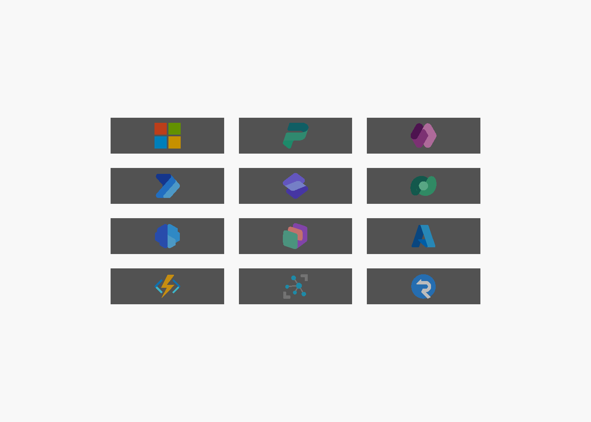

# Plinko bucket sensor insert (IR break beam)

Issue #128. One printed insert per Plinko bucket. It detects a puck resting in the
bucket with an IR break beam. The insert has no LEDs: the chase lights run on the
Plinko display page (Power Pages).

**Board (measured 2026-10-10):** 6 buckets with dividers 88.89, 80.21, 81.38, 79.38, 81.63 and
86.54 mm apart (left to right), 48.85 mm from acrylic to backboard, no pegs in the bucket zone
(the last peg row is about 88 mm above the buckets; pegs are 51.2 mm, 44 of them).

**Pucks:** 49.56 mm diameter x 9.92 mm thick, falling face-on to the board. They can land anywhere
in the 48.85 mm depth, so one flat beam would miss most of them. Each body therefore has a
**funnel**: the top slopes (40 degrees) down into a 14 mm groove at mid-depth, and the beam crosses
the groove. A puck lands on a slope, slides into the groove and blocks the beam. The bodies are
therefore full depth (48 mm), one per bucket width (`body_slotN.stl`).

```
   |<----------------- 4" bucket ----------------->|
   |                     ( puck )                  |
   |/TX tower\ - - - - - - beam - - - - - /RX tower\|   ← beam 8 mm above the top
   |===============================================|   ← top surface (puck rests here)
   |          insert body + magnetic cover         |
   +-----------------------------------------------+   bucket floor
```

| Part | Material | Notes |
|---|---|---|
| **Body** | PLA | Full depth (acrylic to backboard), one per bucket width. Sits on the bucket floor. Two M3 screws from behind the backboard go into heat-set inserts in the rear face. Each end has a tower holding one Adafruit 2167 housing **standing upright** (emitter left, receiver right), pushed in from the rear. The tower tops slope so a puck landing on one rolls into the bucket. |
| **Cover** | PLA, multi-colour | Swappable, held by four pairs of 6 × 2 mm disc magnets and located by two pins. One cover per logo (below); the logo is a 0.6 mm colour inlay in the face. |

- **Sensor fit (measured and test-printed 2026-10-08):** housing 7.96 (along the beam) x 9.80 x
  19.97 mm. A 3.277 mm lens hole sits 4.22 mm from the lens end; the lens tip is 10.86 mm from the
  housing's rear. A lip around the lens end, 8.97 mm from the rear, stands 1.01 mm proud on the lens
  side. The lens end points up and the wires leave the bottom; the wire end sits on the top surface,
  16 mm below the beam. The housing is pushed in from the rear: the lens runs in a slot open to the
  rear face, and the pocket reaches 1.01 mm further toward the bucket over the top `ir_lip_h` (10 mm).
  `exports/stl/fit_test.stl` (receiver end only) fit.
- **Wire raceway:** each housing's wires drop from its bottom end into a 4 × 4 mm channel in the rear
  face. The channel runs the full width to the centre, where the backboard hole is, so all five
  conductors per bucket leave in one place. The backboard closes the channel.
- **Magnets:** four pockets in the body's front face (and four in the cover) take the cover.
- **IR pockets:** they open to the rear face; slide the housings in from behind. The receiver looks
  through a 5 mm-long, 2.5 mm aperture that rejects IR reflected off the acrylic.
- **No moving parts.** The beam is blocked while a puck is in the bucket and clears
  when it's removed. The Pi counts a landing only after the beam has stayed blocked
  for about 150–250 ms, which filters out pucks bouncing through.
## Logo covers



| Family | Covers | Logo colours |
|---|---|---|
| Microsoft | `microsoft` | 4: red, green, blue, yellow |
| Power Platform | `power-platform`, `power-apps`, `power-automate`, `power-pages`, `dataverse`, `ai-builder`, `copilot` | 3 each |
| Azure | `azure`, `azure-functions`, `azure-iot-hub`, `azure-signalr` | 2–3 each |

Each cover exports to `exports/covers/<logo>/`: a `_cover_base.stl` plus one
`_colourN_<hex>.stl` per logo colour, where the hex is the suggested filament colour.

**Printing a cover in Bambu Studio:**
1. Drag all files from one folder in at once.
2. Answer **Yes** to "load as a single object with multiple parts".
3. Assign a filament to each part: the base in your cover colour, and each colour part
   in the closest filament to its hex.

The Microsoft cover needs 5 filaments (base + 4), so either use a second AMS or print its
base in one of the four logo colours.

**How the colours are made:** `logos/build_logo_layers.py` builds each logo from the
repo's icon SVGs (listed in `logos/logos.json`). It keeps the solid colour regions of
each Fluent icon, drops the translucent shading overlays, and merges similar colours down
to 3 per logo. Fine highlights thinner than a nozzle width are dropped.

To add a logo, add its SVG to `logos.json` and re-run `export_parts.ps1`. For a
single-colour cover, run it with `-LogoStyle cutout`: the logo is cut through and the
body colour shows in it.

Status: **sensor fit verified with `fit_test.stl`; the board numbers below are still placeholders (board not yet measured).** The bucket numbers are rough, and the IR housing
orientation is an assumption. Do not batch-print until one insert passes a fit and
detection test on the board.

## Measure / confirm before printing

| Parameter | Now | What to check |
|---|---|---|
| `slot_gap` | 12.7 (0.5 in) | Acrylic to backboard. The insert needs 10.9 mm minimum |
| `slot_w` | 101.6 (4 in) | Gap between dividers; are all 6 the same? |
| `ir_l`, `ir_h`, `ir_w` | 20 × 10 × 8 | Which way the 2167 housing's LED faces. The model assumes the LED is on a 10 × 8 end, centred, with wires out the opposite end |
| `puck_t` | 6 (unknown) | Puck thickness. A puck much thinner than the slot lets more reflected IR leak past |

## Backboard holes

Measured from the left divider (X) and the bucket floor (Z); the export prints them.

| Hole | X | Z |
|---|---|---|
| Wire exit (all sensor wires) | 50.8 | 20 |
| M3 screws | 4.65 and 96.95 | 12.5 |

## Hardware per bucket

- 1 × Adafruit 2167 IR break-beam pair (3 mm); its 5 conductors share one raceway
- 2 × M3 heat-set inserts (M3 × 5.7) + 2 × M3 screws through the backboard
- 8 × 6 × 2 mm disc magnets (4 in the body, 4 in each cover). Glue them in and keep the
  polarity consistent so every cover fits every body

Wiring: emitter and receiver red to 5 V, black to ground. Receiver white goes to a Pi
input with the internal pull-up enabled; never pull it up to 5 V. All six emitters
draw about 120 mA together.

## Export

```powershell
.\export_parts.ps1                                  # body + every cover + previews, validated, with snapshots
.\export_parts.ps1 -SkipSnapshot -Logos power-apps  # quick iteration on one cover
.\export_parts.ps1 -SkipCovers                      # body and previews only
```

The export rebuilds the logo layers, then runs `validate_covers.py`. That check
confirms every part is watertight, and that each cover's base plus its colour parts
add up exactly to a plain cover, so the parts neither overlap nor leave gaps. It
needs Python with `trimesh`.

The STLs are exported in print orientation:

- **Body:** on its back (rear face down). PLA, 3 walls, 20% infill.
- **Cover:** face down (the logo is in the first 3 layers). Use a 0.2 mm layer
  height so the 0.6 mm inlay is exactly 3 layers.

Neither part needs supports.


## Funnel, puck and per-bucket bodies

| File | What |
|---|---|
| `exports/stl/body_slot1..6.stl` | Body per bucket (insert widths 88.1, 79.4, 80.6, 78.6, 80.8 and 85.7 mm). |
| `exports/stl/puck.stl` | Our own puck: 48.9 x 9.5 mm, solid, rounded edge, smooth faces. No decal backing, which is what sticks on the pegs. |
| `exports/stl/fit_test.stl` | Receiver end only, to check the housing fit (passed). |

- Bucket 4 (79.38 mm) is the tightest: 51.9 mm of clear width between the towers for the 49.56 mm
  puck, so about 1 mm each side. Do not go below 78 mm without slimming the towers further.
- Covers and previews are built for one bucket at a time: `.\export_parts.ps1 -Slot 2` (default 4).
  A cover is as wide as its bucket, so build covers per bucket once the logos are chosen.
- Not yet tested on the board: whether pucks slide off the funnel faces at 40 degrees (lower
  `funnel_angle` loses the slide, higher makes it taller), and whether the 2 mm receiver aperture
  rejects enough reflected IR.
