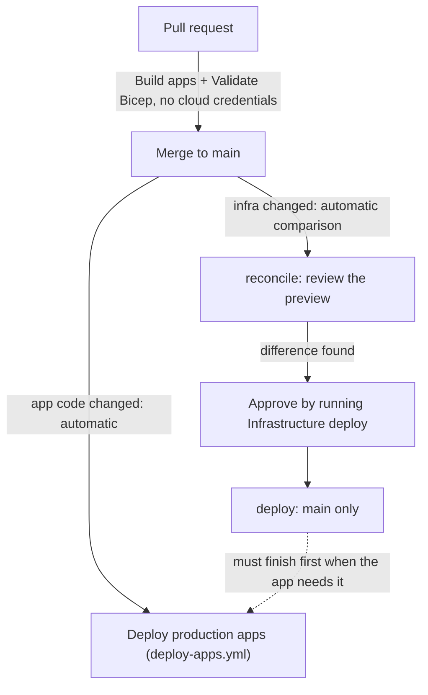

# GitHub Actions deployment

Two workflows release this repo:

- `.github/workflows/deploy-apps.yml` releases `azure/functions/game/` (the Function App),
  `power apps/game-box-control/`, `power pages/copilotiotgame/` (site name
  `CopilotIoTGame`), and `power pages/prize wheel/` (site name `PrizeWheel`). It
  deploys automatically when a relevant change merges to `main`.
- `.github/workflows/deploy-infra.yml` manages the Azure resources in `azure/infrastructure/` (Event Hub,
   SignalR, private endpoints, the game Function App host/plan/storage, game Application Insights, the local Smart Detection action group, the active smart detection alert, and the Function App's access to the hub). The infra deployer needs its reviewed monitoring scopes from `Initialize-InfraIdentities.ps1` before the first monitoring deploy. Every push to `main` automatically
  compares Bicep with Azure and reports whether deployment approval is needed. Deployment is
  still a separate manual action. The separate staff app template is the owner-authorized
  exception: the application workflow provisions it automatically; see [staff wiring](STAFF_API_WIRING.md).

Other site folders, Dataverse solutions, flows, and the Pi firmware are outside both workflows.

## Destination VPN bootstrap

The manual-only `.github/workflows/bootstrap-destination-vpn.yml` is an isolated
first migration stage for issue #259. It does not deploy applications, run `main.bicep`,
modify the source subscription or change existing GitHub release variables.

Target: subscription `9e8c862e-9bba-4363-a21b-c45cabe8b637`, new resource group
`rg-aw-azcom-iot-copilot`, `eastus`. The template creates only `iot-demo-vnet` with
the four reserved subnets, `iot-demo-vpn-pip` and `iot-demo-vpn` (VpnGw1AZ).
New creation uses the documented Generation1 pairing; the source-reported Generation2
is retained on the source and is not replayed into this new gateway.

### IAM prerequisite

An IAM administrator must create the destination resource group in `eastus`, then use
its Access control (IAM) page to assign **Contributor** to the existing user-assigned
managed identity **id-gha-infra-deployer** on this destination group only. Its client ID
is `74d02027-db4d-4128-a46c-184cd9399f9c`; the identity currently lives in the source
subscription and authenticates through the existing `infra-deploy` OIDC environment.
Do not grant Owner, grant source-resource permissions, or change `AZURE_SUBSCRIPTION_ID`.
Contributor is sufficient for this network-only template; it creates no role assignments.

### Preview, deploy and verify

1. Merge the reviewed bootstrap PR into `main`. This bootstrap never deploys on merge.
2. Run the workflow from `main` with `action=preview`:

   ```powershell
   gh workflow run bootstrap-destination-vpn.yml --ref main -f action=preview
   ```

3. Inspect ARM validation, the what-if summary and the retained preview artifact.
   Any real network modification/deletion, ignored real network resource, unexpected
   resource name or cross-scope target fails the run. No preview deploys resources.
4. Acknowledge the additional ongoing gateway/public-IP charges and dispatch:

   ```powershell
   gh workflow run bootstrap-destination-vpn.yml --ref main -f action=deploy -f "confirmation=CREATE BILLABLE DESTINATION VPN"
   ```

5. Record the run URL and commit SHA. The workflow reports the new public IP and checks
   gateway provisioning, SKU, protocol and public root certificate. Gateway provisioning
   can take a substantial part of the workflow's two-hour timeout.
6. Test with a destination VPN client profile and an existing approved client certificate.
   Keep the router on the source VPN until this test passes. Do not connect both VPNs
   concurrently because their VNet/client address plans overlap.

Infrastructure provisioning alone does not establish a working private workload path.
DNS resolver, private DNS, private endpoints and application migration follow separately.
Keep this item at Verify after deployment until the real VPN test passes. Do not delete
the source group until all dependent/shared workloads and their rollback paths have been
validated and source retirement is separately approved.

## Remaining infrastructure migration

Issue #261 continues from the provisioned VPN with `.github/workflows/migrate-infrastructure.yml`.
It is manual-only and main-only; existing app/infrastructure release variables are not
retargeted. The owner deferred a physical VPN connection test until after the remaining
infrastructure move. VPN and end-to-end acceptance are still required before router
cutover or source retirement.

### Destination DNS foundation

Run `action=dns-preview` to validate/preview only five private DNS zones, five destination
VNet links, `iot-demo-dns-resolver` and its static `iot-demo-dns-inbound` endpoint
`10.20.3.4`. The workflow rejects modifications/deletions and any resource outside its
exact DNS allowlist. It references the existing destination VNet without redeploying it.
Azure what-if also reports the three existing VPN foundation resources as Ignore; only
their exact destination IDs with Ignore/NoChange are accepted. Any mutation still fails.

After reviewing the preview and acknowledging additional resolver charges, run
`action=dns-deploy` with confirmation `CREATE BILLABLE DESTINATION DNS`. The workflow
checks the endpoint and each VNet link. It does not change source DNS, the router, private
endpoint records or any workload. Empty destination zones gain service records only when
the destination private endpoints are created in a later stage.

### Service move validation and IAM

`service-move.json` lists the exact 13 ARM service move candidates: IoT Hub, DPS,
Event Hub namespace, SignalR, both Function Apps/plans/storage accounts, Application
Insights, action group and Smart Detector alert. Network resources and user-assigned
deployment identities are not in this move set. An actual move preserves service names,
storage contents and non-ARM device/enrollment state where Azure permits it; validation
is not a promise that every dependency is currently movable.

The existing infra OIDC identity lacks the specific source permission
`Microsoft.Resources/subscriptions/resourceGroups/validateMoveResources/action`.
An IAM administrator must create the custom role from
`azure/infrastructure/roles/move-validator.json` and assign it on the source group only:

```powershell
$source = '2e291b4a-5f03-4dcd-bb56-09643c729adc'
$scope = "/subscriptions/$source/resourceGroups/rg-aw-azcom-iot-copilot"
$principal = '7377b3c8-b72c-4fd0-bf5e-204f07923d60'
az role definition create --subscription $source --role-definition azure/infrastructure/roles/move-validator.json --only-show-errors -o none
if ($LASTEXITCODE -ne 0) { throw 'Validator role creation failed; inspect any existing role rather than overwriting it.' }
az role assignment create --subscription $source --scope $scope --assignee-object-id $principal --assignee-principal-type ServicePrincipal --role 'IoT Migration Move Validator' --only-show-errors -o none
if ($LASTEXITCODE -ne 0) { throw 'Validator role assignment failed.' }
```

This grants no move execution, resource write/delete or secret-read permission. Existing
Reader access supplies source inventory reads; destination Contributor remains scoped to
the destination group. Do not add source Contributor just to run validation.

Then dispatch `action=validate-move`. It reads inventory, rejects missing candidates or
destination collisions, and calls only `validateMoveResources`. Provider errors are
preserved in the workflow log/artifact. Existing source Function VNet integration and
private endpoints may intentionally cause validation to fail: those errors identify the
preparation required for the next reviewed step, not a reason to detach anything now.

### Temporary Function detach and revalidate

The owner accepted temporary source connectivity interruption on 2026-10-07 after
validation run `37620596640` reported Microsoft.Web code `52044` for both source apps.
`action=detach-revalidate` requires exact confirmation
`DETACH REVALIDATE RESTORE SOURCE FUNCTIONS`. No actual resource move is included.

An IAM administrator creates `azure/infrastructure/roles/function-network-preflight.json`
and assigns it on the source Function Apps only. It grants `Microsoft.Web/sites/read`
and `Microsoft.Web/sites/write`, not config/secret read, resource deletion or move
execution. The existing infra identity already has Contributor on the public app; it
has no staff-app write role, so at minimum the staff-app assignment is required. Do not
grant source resource-group Contributor. Existing source VNet Contributor supplies
subnet join permission needed by restoration; the script checks it before detaching.

```powershell
$source = '2e291b4a-5f03-4dcd-bb56-09643c729adc'
$groupScope = "/subscriptions/$source/resourceGroups/rg-aw-azcom-iot-copilot"
$principal = '7377b3c8-b72c-4fd0-bf5e-204f07923d60'
az role definition create --subscription $source --role-definition azure/infrastructure/roles/function-network-preflight.json --only-show-errors -o none
if ($LASTEXITCODE -ne 0) { throw 'Network preflight role creation failed; inspect any existing definition.' }
foreach ($app in @('func-aw-azcom-iot-game', 'func-aw-azcom-iot-staff')) {
   az role assignment create --subscription $source --scope "$groupScope/providers/Microsoft.Web/sites/$app" --assignee-object-id $principal --assignee-principal-type ServicePrincipal --role 'IoT Function Network Preflight' --only-show-errors -o none
   if ($LASTEXITCODE -ne 0) { throw "Network preflight assignment failed for $app." }
}
```

The main-only transaction checks source login, the validation/destination/group permissions,
site-write on both apps, subnet join, Running state, exact original subnet and the complete
move inventory before mutation. It saves `function-integration-snapshot.json`, containing
only names, IDs and original subnet IDs. Each REST PATCH contains only
`properties.virtualNetworkSubnetId`; app settings, runtime/deployment config, identities,
private endpoints, IoT Hub/DPS and stored data are not modified by this script.

After detaching both integrations, it repeats `validateMoveResources`. Regardless of
success or failure, `finally` restores attempted apps in reverse order and verifies their
original subnet IDs. The `always()` cleanup step performs restore-only verification or
recovery from the validated snapshot. Other provider errors can still make the run fail
even when restoration succeeds; check `function-preflight-result.json` and
`function-recovery-result.json`, not just the run conclusion. Never interpret a passing
preflight as a resource move.

For recovery, retained artifacts contain the snapshot and provider diagnostics, no secrets.
Forced runner termination can prevent both cleanup and artifact upload; operators must
then read both source site states and restore only the integration property to the known
original subnet:
`/subscriptions/2e291b4a-5f03-4dcd-bb56-09643c729adc/resourceGroups/rg-aw-azcom-iot-copilot/providers/Microsoft.Network/virtualNetworks/iot-demo-vnet/subnets/function-integration`.
Use the same Web sites PATCH API `2024-04-01` and verify the result. Do not replay a full
site/config resource or overwrite an unexpected concurrent subnet change. Source
deployment workflows must remain paused during the temporary transaction.

### Actual move gate

The workflow still has no actual move, source deletion or private endpoint detachment
action. Review further provider errors and separately authorize those actions and their
outage/rollback window. Both Functions must lose source VNet integration for
App Service moves; unsupported private endpoint connections must be removed/recreated.
This can interrupt private telemetry even when the public APIs remain reachable.

Preserve Function settings, storage/deployment packages and Event Hub checkpoints through
ARM moves instead of an incomplete fresh `main.bicep` deployment. Capture RBAC assignments
and restore Event Hubs Sender/Receiver permissions at their destination scopes. Check IoT
Hub route subscription metadata and DPS linked-hub configuration without overwriting
device/enrollment state. The shared Log Analytics workspace outside this group needs an
explicit retain/move decision; it is not included in the 13-resource manifest.

User-assigned deployment identities cannot move: replace them and their OIDC/RBAC before
deleting the source group that currently owns them. Recreate private endpoints/DNS records
and restore both Functions' destination integration. Only then retarget release variables
and run the deferred VPN, DNS, API, staff auth, physical telemetry and player-claim tests.
Do not delete the source group or rotate device/enrollment keys as part of preflight.

## Parallel Function rebuild and cutover

The owner requested a faster move/rebuild path after preflight `37627593468` could not
confirm public-app detachment using a null PATCH. The script stopped before touching
the staff app; both source apps are Running on their original subnet. Do not retry
detachment as part of this parallel rebuild.

`rebuild-destination-functions.yml` stages these destination resources only:

- public app `func-aw-iot-game-v2`, its FC1 plan and storage `stawazcomiotgamev2`
- staff app `func-aw-iot-staff-v2`, its FC1 plan and storage `stawazcomiotstaffv2`
- package containers and the `iot-rebuild-signalr-pe` destination private connection
   to the existing source SignalR service

The new URLs deliberately differ from the source so the old apps do not need deleting
to free names. CORS and an allowlisted runtime-setting set are inherited from the public
source app inside ARM. Dataverse/SignalR/Direct Line/preference secrets are not printed,
returned as deployment outputs, passed in runner arguments or saved as artifacts.
The two source settings-storage connection strings are not copied: staging uses its own
new host/package storage. Staff Entra tenant/audience/connector IDs come from the reviewed
non-secret staff configuration. Keep shared-key deployment storage consistent with the
current Flex model; this stage does not change production storage authentication.

Before merging registration-gate code, set repository variable `AZURE_MIGRATION_FREEZE`
to `true` with owner approval. Normal `deploy-apps.yml` still builds/tests every app but
skips backend/frontend/production deployment jobs. This prevents an automatic source
release during migration; it does not retarget any existing URL or identity. Keep that
freeze until cutover configuration and all source dependencies are resolved.

The staging workflow builds the same locked Node 22 runtime-only ZIP and runs backend
tests. Its main-only `preview` performs ARM validation and ResourceIdOnly what-if; only
the exact new names may be created. Existing destination network/DNS resources may be
Ignore/NoChange only. Any modifications, deletions, source-scope target or unexpected
resource stops the run. `stage` also requires confirmation
`STAGE BILLABLE DESTINATION FUNCTIONS` for additional hosting/storage/endpoint charges.

Staged apps use `MIGRATION_STAGING=true`. Telemetry and maintenance are not registered,
because Linux cannot disable these hyphenated function names via per-function Disabled
settings. The workflow checks the flag and actual registrations, public kiosk-state 200,
and staff unauthenticated kiosk-state 401. These checks do not mutate player/prize data.
No source apps, private endpoints, stored data or deployment identities are deleted.

Run `validate-stateful` in `migrate-infrastructure.yml` to validate the nine non-Web
candidates from `service-move.json`: IoT Hub, DPS, Event Hub, SignalR, the two old storage
accounts and active monitoring. This reuses the existing validator-only IAM and preserves
names/device/enrollment/storage state through move planning. It performs no move or
private endpoint detachment. Inspect provider errors before the next reviewed move stage.

Before actual cutover, preserve device/enrollment keys/state and storage/checkpoints;
move supported stateful services, recreate private endpoints and restore RBAC; repoint
the SignalR bridge if its resource ID changes; replace the source-owned GitHub managed
identities and OIDC permissions; update API/connector/Pi URLs and normal release ownership.
Enable destination telemetry/timers only after stopping their source counterparts so no
consumer group or maintenance job runs twice. Complete the deferred VPN, DNS, authenticated
staff, physical telemetry and claim tests. Then retire the two old apps/plans and unused
source infrastructure. Never delete the source group while it still contains stateful
resources, needed storage or the active GitHub identities. No whole-group delete is in
this staging workflow, even when the owner permits replacement of stateless apps.

## How the pieces fit

| | Application workflow | Infrastructure workflow |
|---|---|---|
| File | `deploy-apps.yml` | `deploy-infra.yml` |
| Covers | Function App code, Game Box Control, kiosk Code Site, PrizeWheel Code Site | `azure/infrastructure/`: VNet/subnets, Event Hub and its private endpoint, consumer groups, SignalR, private endpoints, game Function host/plan/storage, game Application Insights, local Smart Detection action group, active smart detection alert, Function App Event Hub access |
| When it deploys | automatically on merge to `main` | checks Azure automatically on every push to `main`; `deploy` is a manual approval action allowed from `main` only |
| GitHub environment | `production` | `infra-deploy` (reconciliation preview and deploy) |
| Azure identity | `id-gha-copilot-iot-game-deploy` | `id-gha-infra-reader` and `id-gha-infra-deployer`, least privilege |
| Details | [Application workflow](#application-workflow-flow) and the sections below | [Infrastructure workflow](#infrastructure-workflow-deploy-infrayml) |

Not deployed by CI: the IoT Hub and DPS (recorded and drift-checked only, and the infra
identity cannot write to them), DPS enrollment keys and derived device keys (see
[DPS enrollment migration and device registration](DPS_ENROLLMENT_MIGRATION.md)), Dataverse solutions and Power Platform components (PAC), the
Copilot Studio agent, and the panel Pi firmware (`hardware/raspberry-pi/deploy.ps1`, copied over
SSH and restarted by hand).

Everything targets one Azure tenant, subscription, and resource group
(`rg-aw-azcom-iot-copilot`) and one Power Platform environment. The GitHub environments are
credential and branch gates, not separate deployment targets.

## Application workflow: flow

1. Work on a feature branch and open a PR to `main`. Four credential-free jobs build the
   Function App, Game Box Control Code App, kiosk Code Site and PrizeWheel Code Site in
   parallel. The `Build apps` aggregation job remains the single required branch-protection
   check. PRs never deploy.
2. Merge the PR. Pushes to `main` touching any deployed app or the workflow build
   all apps and retain deployment artifacts for 14 days. Documentation-only
   pushes do not deploy.
3. `Deploy and verify backends` uses the `production` environment, checks required settings,
   provisions and deploys the staff Function App, and requires an unauthenticated request to
   return 401. With `STAFF_API_CUTOVER_READY=true`, it then deploys the public Function App.
   After that backend gate passes, three isolated jobs push the Code App and upload both Code
   Sites in parallel. With the flag unset/false, only the staff backend is released. The final
   `Deploy production apps` aggregation job fails unless every required deployment succeeds.
   The Function ZIP contains only host/package metadata, compiled code, and production dependencies.
4. Validate the live kiosk and backend, then update related plan items from Verify
   to Done. A successful upload alone does not prove the application works.

Workflow runs are serialized and a running release is not cancelled by a new push. Within one
run, independent builds run together, the backend deploy and health check form the release gate,
and the three frontend deploys then run together. The infrastructure workflow is independent and
can run at the same time. When application code depends on a new infrastructure resource, deploy
and validate that infrastructure first, then merge or dispatch the application release. This is
not an atomic release: a frontend may fail after the backend is updated, so keep backend changes
compatible with the previous frontend during rollout.

## Application workflow: one-time configuration

Create a GitHub environment named `production`. Restrict deployment branches to
`main`; add required reviewers if your release policy requires them. Protect
`main` with PR reviews and the `Build apps` status check.

Set these **repository Actions variables** (Settings > Secrets and variables >
Actions > Variables). Keep `AZURE_FUNCTIONAPP_NAME` repository-scoped so the build
and deploy jobs use the same API host; do not override it at environment scope.

| Variable | Value/purpose |
|---|---|
| `AZURE_FUNCTIONAPP_NAME` | `func-aw-azcom-iot-game` for the consolidated IoT resource group deployment |
| `AZURE_CLIENT_ID` | Deployment identity/application client ID |
| `AZURE_TENANT_ID` | Azure tenant ID |
| `AZURE_SUBSCRIPTION_ID` | Subscription containing the Function App |
| `POWER_PLATFORM_ENVIRONMENT_URL` | Target Dataverse HTTPS URL, not the public website URL |
| `POWER_PLATFORM_TENANT_ID` | Target Power Platform tenant ID |
| `POWER_PLATFORM_CLIENT_ID` | Power Platform deployment application ID |
| `POWER_PLATFORM_SOLUTION_NAME` | Optional; defaults to `CopilotIoTGame` and is passed to `pac code push --solutionName` |
| `POWER_PAGES_WEBSITE_ID` | Optional; defaults to the live `CopilotIoTGame` Code Site ID |
| `POWER_PRIZE_WHEEL_WEBSITE_ID` | Optional; defaults to the live `PrizeWheel` Code Site ID |
| `SOLUTION_DIAGRAM_URL` | Optional; defaults to `https://copilotiotgame.powerappsportals.com/kiosk/solution` for the PrizeWheel "Explore this solution" button |

Create the `POWER_PLATFORM_CLIENT_SECRET` **environment secret** in `production`.
Use a dedicated deployment application registered as a Dataverse application
user with permissions to upload the site and push the Code App; the backend's
runtime identity, which only accesses game tables, is not sufficient. Rotate
this secret when needed.

The Code App uses a per-user OAuth custom connector; no Function keys are injected into its build. Staff resource names and Entra IDs come from `azure/infrastructure/staff-api.prod.json`. `staff-api.bicep`, invoked only by `deploy-apps.yml`, is the owner for the staff Function App, plan, storage, package container, VNet integration and staff auth settings; do not add those resources to `main.bicep` or the reference manifest. An IAM administrator must first run the reviewed [deployment access bootstrap](STAFF_API_WIRING.md#deployment-access); the existing deployment identity cannot provision these resources yet. Leave repository variable `STAFF_API_CUTOVER_READY` unset/false for the staff-only bootstrap release. Complete [STAFF_API_SETUP.md](STAFF_API_SETUP.md), commit the actual connector binding, then set the flag true for coordinated cutover. The workflow requires an unauthenticated staff request to return 401 before advancing. Remove legacy CODE_APP_*_FUNCTION_KEY secrets and rotate previously exposed keys after acceptance.

The workflow authenticates PAC with `--url` instead of `--environment` for the
service-principal profile. `--environment` causes PAC to query the Business
Application Platform admin environment endpoint during auth, which requires
broader Power Platform admin-management permissions than the Dataverse
Application User role needed for code-site upload.

PAC still requires the deployment app to be registered as a Power Platform admin
management application before service-principal auth can complete in GitHub
Actions. A tenant admin with `ManageAdminApplications` permission must run:

```powershell
pac admin application register --application-id 6bf6a3f1-39d1-4b99-99e7-8460dd1a7d3d
```

Configure Azure OIDC federation for the Azure deployment identity:

- Issuer: `https://token.actions.githubusercontent.com`
- Subject: `repo:Andworx@226577816/Copilot-IoT-Game@1350685991:environment:production`
- Audience: `api://AzureADTokenExchange`
- Assign Website Contributor scoped to the consolidated Function App (or a tested
  equivalent deployment role). No Azure publish-profile secret is used.

The game Function App host, Flex Consumption plan, and deployment storage are
declared by the infrastructure workflow. Current target: `func-aw-azcom-iot-game`
in `rg-aw-azcom-iot-copilot`, hosted on plan `ASP-rgawazcomiotcopilot-ec55`
with dedicated storage account `stawazcomiotgamefn` and shared Serverless
SignalR resource `signalr-aw-iot-copilot`. Preserve its runtime
Dataverse/SignalR settings and storage configuration. The application workflow
does not provision infrastructure or publish `local.settings.json`. The deploy job uses the
prebuilt zip package with `sku: flexconsumption` and `remote-build: false`; do
not add the legacy `SCM_DO_BUILD_DURING_DEPLOYMENT` app setting to the Flex
Consumption app. Configure CORS for the public Power Pages and Code App origins.
Power Pages keeps its existing `VITE_API_BASE_URL`. The Code App uses the connector, with no direct Azure URL or client-bundled credentials.

The Power Platform environment must have the intended Game Box Control Code App
initialized with `power.config.json`; the workflow runs `pac code push
--environment "$POWER_PLATFORM_ENVIRONMENT_URL" --solutionName
"$POWER_PLATFORM_SOLUTION_NAME"` from `power apps/game-box-control`. The same
environment must support Code Sites, allow JavaScript attachments, and have the
intended Power Pages sites. The install action provides PAC; Code Sites require
PAC 1.44 or later. For the first Code Site upload, activate the resulting
inactive site in Power Pages and configure table permissions in its admin UI.
Subsequent uploads update the active site. Verify `powerpages.config.json` before
a release; changing its site name can target a different site.

**Which Power Pages site gets updated.** `pac pages upload-code-site` has no
website-ID parameter. It finds the site to update from the `.powerpages-site/`
folder (site metadata plus the per-environment manifest of RecordId + checksum
per record) sitting next to the compiled code, and creates a brand-new website
when that folder does not match a site in the environment. A checked-in copy
cannot be trusted for this: every upload rewrote the copy's IDs, so each deploy
created another "CopilotIoTGame" website and the live one (bound to
`copilotiotgame.powerappsportals.com`) was never updated, while every run still
reported success.

The deploy job therefore pins each live site by ID (`POWER_PAGES_WEBSITE_ID`,
a repository variable that defaults to `4938f099-b8dd-485f-a5c2-3c4ad4b7e02a`,
and `POWER_PRIZE_WHEEL_WEBSITE_ID`, which defaults to
`5dadde98-1e91-4a34-8182-1b0a87466e58`)
and, before uploading, runs `pac pages download-code-site --webSiteId` to fetch
each site's real `.powerpages-site/` into its artifact. The download fails the
deploy if a site cannot be fetched, and a post-upload step fails it if the
uploaded website ID is not the pinned one, so a wrong target is loud instead of
silent. Nothing is committed back to `main`.

**How `.powerpages-site/` is meant to be used.** It is generated state owned by
the live site (record IDs, checksums, the site's pages, templates, settings and
web files), not source code, so it is deliberately **not tracked in git** and is
listed in `power pages/copilotiotgame/.gitignore`. It used to be committed; every
upload rewrote its IDs and the committed copy drifted away from the live site,
which is what caused the duplicate-website incident. Rules:

- CI never needs it in the repo: the deploy job downloads it from the live site
  on every run and discards it afterwards.
- Locally you only need it for an explicit manual recovery upload. Get it with
  `pac pages download-code-site --webSiteId <live id>` (steps in
  `PAC_COMMANDS.md`), upload immediately, and leave it uncommitted.
- Never hand-edit it, copy it between environments, or reuse an old download:
  stale IDs make `pac` create a new website instead of updating the live one.
- If a copy is lying around and you are unsure about it, delete it. It is always
  recoverable from the live site.

**Browser console CSP messages.** The portal sends its own
`Content-Security-Policy` header (`script-src 'self' content.powerapps.com ...
'nonce-...' 'inject-hashes'`), and the browser console reports blocked inline
scripts at `(index):30`, `:53` and `:59`. Those scripts are generated by Power
Pages (the "This site is private" banner and page wrapper); their hashes change
between loads, and the repo's build output contains only external module
scripts, so there is nothing to externalize or whitelist. The site works
normally with these messages present. If a page shows the platform "Something
went wrong" error instead, check the deploy first (the run's "Verify Power Pages
upload targeted the live site" step), then restart the site and test in a
private window: a stale browser cache can keep showing the error after the site
has recovered (issue #48).

If the live site is ever recreated, look up its new ID with `pac pages list`
(the one whose `primarydomainname` is the portal's domain) and set the
`POWER_PAGES_WEBSITE_ID` repository variable. Duplicate "CopilotIoTGame"
websites in the environment are always mistakes and can be deleted, but check
the domain first: only one is bound to the portal URL.

Code Apps also enforce the target environment's Content Security Policy. When a
frontend calls the Function App directly, add the production Function App origin
to the environment's Code App `connect-src` allowlist in the Power Platform
admin center:

```text
https://func-aw-azcom-iot-game.azurewebsites.net
```

This is separate from the GitHub Actions `AZURE_FUNCTIONAPP_NAME` variable and
cannot be configured by `pac code push`. If the allowlist still contains only
the retired `func-aw-azcom-copilot-iot-game.azurewebsites.net` origin, the
browser blocks requests before they reach Azure Functions, even though the
Function App and its CORS settings are healthy. After changing the policy,
reload the Code App and verify `/api/prize-types`, `/api/device-profiles`, and
`/api/kiosk-state` in the browser network panel.

## Infrastructure workflow (`deploy-infra.yml`)

`.github/workflows/deploy-infra.yml` manages the Azure resources this repo owns, defined in
[`azure/infrastructure/`](../azure/infrastructure/README.md): the VNet and subnets, Event Hub namespace, the `iot-telemetry`
hub and its consumer groups, SignalR service, private endpoints, the game Function host/plan/storage, the game Application Insights component, local Smart Detection action group, active smart detection alert, and the game Function App's read access to the hub. It
is separate from `deploy-apps.yml` on purpose: infrastructure changes can stop telemetry for
every device, so each relevant merge is compared with Azure and applied only after a separate
manual approval.

Everything else in the resource group (IoT Hub service, DPS, and the legacy Function App/plan/storage)
is currently **recorded but never deployed**. Its snapshots are checked as a
post-deployment safety guard. The deploy identity has no write access to it, except for the custom IoT Hub private endpoint approval action required to deploy the IoT Hub private endpoint. The shared default Log Analytics workspace is referenced by the game Application Insights component but is not owned or deployed by this repo. The Smart Detection action group is now local to `rg-aw-azcom-iot-copilot`; the old demo resource group action group is not part of the target design. These resources will
move into Bicep one at a time as their deployment behavior is validated; see
[`azure/infrastructure/README.md`](../azure/infrastructure/README.md).

### What triggers what

| Trigger | Jobs that run | Azure access |
|---|---|---|
| PR touching `azure/infrastructure/**` or the workflow | `validate`: compile and lint the Bicep, confirm every reference snapshot exists | none |
| Every push to `main` | `validate`, then `reconcile`: compare Bicep with Azure and fail with a change summary when approval/deployment is needed | `infra-deploy`; read-only operation |
| Manual, `action = what-if` | Run the same reconciliation check on demand; changes nothing | `infra-deploy` (deployer identity, `main` only) |
| Manual, `action = deploy`, from `main` only | `validate`, then `deploy`: assign the game Function App a managed identity, deploy `main.bicep` (incremental), merge the telemetry settings, re-check snapshots | `infra-deploy` (`main` only) |

This shared-infrastructure workflow never deploys automatically. The staff-only template is
released separately by deploy-apps.yml. Merging an infrastructure change checks Azure and
notifies repository watchers through the failed reconciliation check when Azure differs. Review
the job summary and run `deploy` to approve it. After deployment, rerun the failed reconciliation
job or dispatch `what-if`; it passes when Azure matches Bicep.

Deployments use ARM incremental mode. Resources absent from the template are retained, and Azure
reconciles declared resources to their desired properties. ARM can still issue a PUT for a declared
resource even when most properties are unchanged, so each resource must be captured and validated
individually before expanding the template. The known read-only Event Hub
`privateEndpointConnections` what-if difference is filtered from the approval signal.

Azure also returns VPN gateway runtime health, migration/default flags, and child
resource `id`/`type` metadata that cannot be declared. Reconciliation filters only
those exact leaf paths. Array parents are inspected recursively, so a real change to
the gateway IP configuration, root certificate, client pool, protocol, SKU, or BGP
configuration still fails reconciliation. Unit tests cover this behavior.

### GitHub environments, Azure identities, and permissions

The two environments below are **GitHub Actions environments**, not Azure or Power Platform
environments: everything still targets the one tenant, one subscription, and one resource group
(`rg-aw-azcom-iot-copilot`). They exist so each kind of job gets its own credential and its own
branch rule. The existing `production` environment and its identity
(`id-gha-copilot-iot-game-deploy`) are for the app workflow and are unchanged.

| GitHub environment | Azure identity | What that identity can do | Protection |
|---|---|---|---|
| `infra-readonly` | `id-gha-infra-reader` | Reader on the resource group and nothing else. Retained for reference inspection while resources are migrated from snapshots into Bicep. | no active workflow job |
| `infra-deploy` | `id-gha-infra-deployer` | Runs reconciliation previews and approved deploys. `Infra Deployment Operator` (deployments only), Reader, Private DNS Zone Contributor, and custom Action Group Operator on the resource group; Contributor on the Event Hub namespace, SignalR service, `func-aw-azcom-iot-game`, `ASP-rgawazcomiotcopilot-ec55`, `stawazcomiotgamefn`, `iot-demo-vnet`, `iot-demo-dns-resolver`, `iot-demo-vpn-pip`, `iot-demo-vpn`, `iot-demo-eventhub-pe`, `iot-demo-signalr-pe`, `iot-demo-game-function-pe`, `iot-demo-game-storage-blob-pe`, and `iot-demo-iothub-pe` only; custom IoT Hub private endpoint approval role on `iothub-aw-iot-copilot`; assign only the *Azure Event Hubs Data Receiver* role, only on the `iot-telemetry` hub (ABAC-restricted) | deployment branches limited to `main`; no required reviewer (not available on the Free plan) |

The `infra-deploy` environment has **no required reviewer**: the org is on GitHub's Free plan, which
does not offer that rule for private repositories. What gates a deploy instead: it is a manual action
(nothing deploys on merge), the environment only accepts `main` (so the Azure login is unavailable to any
other branch), `main` itself is protected by PR review, and the deploy identity can only change the
adopted Event Hub, SignalR, game Function host/plan/storage, networking, private endpoint, and private DNS resources. `what-if` shows exactly what a deploy would do. If the org
later moves to a plan with required reviewers, add one to `infra-deploy`; no workflow change is needed.

Each identity's GitHub credential is bound to its environment name, so a job can only log in as
the identity that matches its environment. The deploy job can never modify the IoT Hub, DPS,
the legacy Function App, or unrelated storage accounts, because the identity has no permission to.

### One-time setup

1. **Azure identities and roles.** Someone with Owner or User Access Administrator on the
   resource group runs `azure/infrastructure/scripts/Initialize-InfraIdentities.ps1`. Try `-PreflightOnly` first
   (it confirms the permission and changes nothing) or `-WhatIf`. The script is safe to re-run.
   Contributor is not enough: it can create the identities but not the roles.
2. **GitHub environments** (Settings > Environments):
   - `infra-readonly`: no protection rules.
   - `infra-deploy`: **Deployment branches: selected branches, `main`**. Add **Required
     reviewers** too if the plan allows it. Create it with these rules *before* the first run,
     because GitHub creates a missing environment on first use with no protection at all.
3. **Repository variables** (Settings > Secrets and variables > Actions > **Variables**, not
   Secrets: they are client IDs, not secrets, and the workflow reads `vars.*`):

   | Variable | Value |
   |---|---|
   | `AZURE_INFRA_READER_CLIENT_ID` | client ID of `id-gha-infra-reader` |
   | `AZURE_INFRA_DEPLOYER_CLIENT_ID` | client ID of `id-gha-infra-deployer` |
   | `AZURE_TENANT_ID`, `AZURE_SUBSCRIPTION_ID` | already set for the app workflow; shared |

   The infra workflow uses no secrets. Get the client IDs with
   `az identity show -g rg-aw-azcom-iot-copilot -n <identity> --query clientId -o tsv`.
4. **Workflow on `main`.** `workflow_dispatch` only works for a workflow file on the default
   branch, so merge the PR that adds it before running any of the manual actions.

### Running it

```powershell
gh workflow run deploy-infra.yml --ref main -f action=what-if   # preview, read-only
gh workflow run deploy-infra.yml --ref main -f action=deploy    # main only
gh run list --workflow deploy-infra.yml --limit 5
gh run watch <run-id> --exit-status
```

Or use Actions > Infrastructure > Run workflow. Read-only checks also work locally with the Azure
CLI and PowerShell 7 (`pwsh`): `az deployment group what-if ...` and
`./azure/infrastructure/scripts/Invoke-ReferenceSnapshot.ps1 -Mode Check` (commands in `azure/infrastructure/README.md`).

Always run `what-if` and read it before `deploy`. For the Event Hub lockdown,
expect the namespace and its default network rule set to change to private-only:
public access Disabled and trusted Microsoft services enabled. Azure normalizes
the default action to Allow while the public endpoint is disabled; this does not
permit public traffic.
The trusted exception is required for the identity-based IoT Hub route. After
deployment, the workflow checks the private endpoint, Function VNet integration,
route authentication, and sender/receiver roles. Live Pi-to-kiosk telemetry still
requires owner validation.

### Release order

App changes that depend on new infrastructure need the infrastructure first, because merging to
`main` deploys the apps automatically. The telemetry function needs the `gamefunc` consumer
group, the Function App's managed identity, and its Event Hub role before it can read anything.



For the telemetry pipeline, in order:

1. Merge the infra PR (this adds the workflow to `main`).
2. Review the automatic reconciliation summary, then run `deploy`. Dispatch `what-if`
   afterward to confirm Azure matches Bicep.
3. Merge the application PR; `deploy-apps.yml` ships the telemetry function.
4. Restart the panel Pi service, then verify the live path (Pi to kiosk).
5. Keep the plan items at Verify until step 4 passes.

### Settings: what CI sets and what stays manual

`deploy` merges these into the game Function App. It only adds or updates these names and
leaves every other setting alone.

| Setting | Set by | Notes |
|---|---|---|
| `IoTHubEventHubConnectionString__fullyQualifiedNamespace` | infra `deploy` | identity-based Event Hub access, so no key is stored |
| `IOT_EVENTHUB_NAME`, `IOT_EVENTHUB_CONSUMER_GROUP` | infra `deploy` | `iot-telemetry`, and `gamefunc`, a group used by this app only |
| `DATAVERSE_*`, `AzureSignalRConnectionString` | by hand, already set | secrets are never written by CI |
| `DIRECTLINE_SECRET` | by hand, when the Copilot Studio agent is ready | until set, `/api/directline-token` returns 503 and the kiosk shows the standard steps |

### Troubleshooting

| Symptom | Likely cause |
|---|---|
| `AADSTS700213` / no matching federated identity | The job's environment name does not match the identity's credential (`infra-readonly` / `infra-deploy`), or the environment does not exist |
| `AuthorizationFailed` on `what-if` or `deploy` | The identity's role assignment is missing; re-run `Initialize-InfraIdentities.ps1` |
| `Authorization failed for template resource ... /write` on reconciliation | The check was run as a read-only identity. ARM checks that the caller could write every resource in the template, even though what-if changes nothing, so reconciliation runs as the deployer identity |
| Reconciliation fails after a merge | Azure differs from `azure/infrastructure/`. Review the listed Create/Modify/Delete operations and run the manual `deploy` action if they are intended |
| `deploy` job does not start | Not run from `main` (the environment only accepts `main`) |
| Telemetry function does not start after `deploy` | Role assignments can take a few minutes to take effect; check the Function App's log stream, and confirm the three settings above exist |
| Retired `func-aw-iot-copilot` still runs | It should not exist after issue #215 cleanup. If it reappears, confirm no rollback was intentionally performed, then rerun the cleanup validation in `docs/LEGACY_FUNCTION_RETIREMENT.md`. |

## Copilot, Claude, and Codex procedure

All three assistants use the same workflow, not separate deployment mechanisms.
Read this document, run the local builds, submit a PR, and inspect the Actions
result for the merged commit. Do not use local cloud publishing as the default.

```powershell
npm --prefix azure ci
npm --prefix azure run build
npm --prefix "power apps/game-box-control" ci
npm --prefix "power apps/game-box-control" run build
npm --prefix "power pages/copilotiotgame" ci
npm --prefix "power pages/copilotiotgame" run build

# Redeploy current main when requested (also available via Actions > Run workflow).
gh workflow run deploy-apps.yml --ref main
gh run list --workflow deploy-apps.yml --limit 5
gh run watch <run-id> --exit-status
gh run view <run-id> --log-failed
```

Infrastructure follows the same rule (see [Infrastructure workflow](#infrastructure-workflow-deploy-infrayml)):

```powershell
gh workflow run deploy-infra.yml --ref main -f action=what-if   # read-only preview
gh workflow run deploy-infra.yml --ref main -f action=deploy    # only when explicitly asked
```

Run `what-if` and show its output before `deploy`, and never run `deploy` unprompted. Do not
run `Initialize-InfraIdentities.ps1`, `az deployment group create`, or
`Set-FunctionAppSettings.ps1` locally; the read-only checks (`what-if`, `Invoke-ReferenceSnapshot.ps1
-Mode Check`) are fine. Never change the IoT Hub or DPS from this repo.

Manual dispatch on any other branch builds only; deployment is restricted to main.
The workflow must first be merged to the default branch to appear for dispatch.
Report the run URL, commit SHA, and live verification result. If settings or
permissions are missing, identify them without printing credentials.

Check `GET /api/kiosk-state`, load `/kiosk/info` and a kiosk device route, and
validate mode changes/SignalR through the authorized control app. Check the
browser for API/CORS failures. These live checks are manual; the workflow builds
and uploads but does not change game state for a smoke test.

For a failed upload or push, fix the reported configuration/permission issue and
rerun the failed job from the same run while artifacts remain available. To roll
back code, revert the problematic change through a PR and merge it so all apps
redeploy. Do not dispatch an old branch expecting a rollback. Local publishing
commands in component docs are reserved for explicitly requested
recovery/bootstrap work.

## Action references

- [Azure Functions action](https://github.com/Azure/functions-action): Function ZIP deployment.
- [Azure OIDC configuration](https://docs.github.com/en/actions/how-tos/secure-your-work/security-harden-deployments/oidc-in-azure): federation setup.
- [Power Platform install action](https://github.com/microsoft/powerplatform-actions/tree/main/actions-install): PAC installation.
- [Power Pages Code Sites](https://learn.microsoft.com/en-us/power-pages/configure/create-code-sites): Code Site upload and activation.
- [Power Apps Code Apps](https://learn.microsoft.com/en-us/power-apps/developer/code-apps/): Code App build and `pac code push` workflow.

Do not substitute classic `upload-paportal` / `pac pages upload` actions or GitHub
Pages actions: this repository deploys a Power Pages Code Site and a Power Apps
Code App.

### Network baseline preview

Use Infrastructure > Run workflow > main > `network-what-if` for the remaining captured
[network baseline](../azure/infrastructure/network/README.md). PRs compile it without credentials.
The main-only preview uses the existing infra-deploy identity with ProviderNoRbac;
it does not require write grants for the baseline-only resources and does not apply them. This
action is separate from the main what-if/deploy, which now owns the VNet/subnets, private DNS
zones/links, DNS resolver/inbound endpoint, and Point-to-Site VPN gateway/public IP. No whole-baseline apply action exists.
