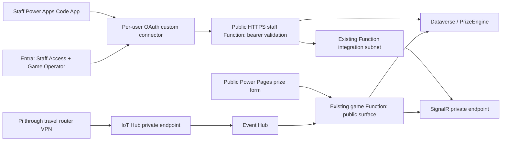

# Staff API and network wiring

Recorded 2026-09-29. This separates operator-reported network checks, read-only
Azure verification, prepared code and work still awaiting release. The staff backend is deployed and the connector read test returned HTTP 200. The hosted Code App cutover remains pending.

## Selected request paths



The browser calls Power Platform, not the staff Azure hostname. The connector
sends the operator's delegated token to the new public HTTPS API. This avoids the
hosted Code App's browser local-network restriction without disabling private DNS.
Sharing the Code App does not grant the API role. Every staff operation requires
both `Staff.Access` and `Game.Operator`, plus the expected connector client ID.
The staff drawing display polls authenticated state every five seconds; it no
longer connects directly to the private SignalR hub. Kiosk telemetry still uses
SignalR. No APIM gateway is being provisioned.

## Entra configuration

| Item | Recorded value / status |
|---|---|
| Tenant | `7cea0515-a5e4-4e8a-8f2a-6d1ad5d6b9f8` |
| IoT Game Staff API client ID | `00754488-3e99-4b4f-b55d-66cf161182d7` |
| API identifier URI | `api://00754488-3e99-4b4f-b55d-66cf161182d7` |
| Delegated scope | `Staff.Access`; definition verified read-only |
| App role | `Game.Operator`, Users/Groups; definition verified, operator access now confirmed by owner-reported GetKioskState HTTP 200 |
| Token version | `api.requestedAccessTokenVersion=2`, verified |
| IoT Game Staff Connector client ID | `5645dd87-3e8f-437b-a1d8-70ed447ad24b` |
| Connector API permission | Staff.Access registration verified; administrator consent reported granted by owner |
| Connector redirect URI and secret | Created; exact current redirect recorded below; secret remains only in Power Platform |
| Per-user connection and PAC binding | Working connection supplied by owner; real PAC-generated binding prepared in the follow-up PR |

The API validates RS256 signature, tenant v2 issuer, audience (API client GUID),
expiry, token version, operator identity, delegated scope, role and `azp` client.
Missing/invalid bearer tokens return 401; insufficient permissions return 403;
missing server auth configuration returns 503. HTTP triggers are anonymous only
at the Functions host layer so the in-code validator can process the bearer token.
Function keys and browser identity headers cannot substitute for it.

## Provisioning and runtime configuration

Target subscription `2e291b4a-5f03-4dcd-bb56-09643c729adc`, resource group
`rg-aw-azcom-iot-copilot`, East US. Non-secret inputs live in
[`infra/staff-api.prod.json`](../infra/staff-api.prod.json).

| Resource | Configuration |
|---|---|
| `func-aw-azcom-iot-staff` | New Linux Flex Consumption, Node 22, public HTTPS, no private endpoint |
| `func-aw-azcom-iot-staff-plan` | FC1; 2,048 MB instances, max 40, no always-ready instances |
| `stawazcomiotstafffn` | New Standard LRS StorageV2; private package container `staff-function-package`; authenticated public storage endpoint |
| Outbound integration | Existing `iot-demo-vnet/function-integration`; Microsoft.App/environments delegation verified |
| Monitoring | Reuses existing game app's Application Insights connection setting |
| Identity | New system-assigned identity; not yet used for storage or Dataverse credentials |

ARM reads these source settings from `func-aw-azcom-iot-game` server-side:
`DATAVERSE_URL`, `DATAVERSE_TENANT_ID`, `DATAVERSE_CLIENT_ID`,
`DATAVERSE_CLIENT_SECRET`, `AzureSignalRConnectionString`, optional
`GRAND_PRIZE_EMAIL_FROM_SYSTEM_USER_ID`, and `APPLICATIONINSIGHTS_CONNECTION_STRING`.
The staff app initially shares the existing Dataverse application's permissions.
If a source value becomes a Key Vault reference, the staff identity must receive
the corresponding vault access before that value can work.

The new storage's key-based connection string supplies `AzureWebJobsStorage` and
`DEPLOYMENT_STORAGE_CONNECTION_STRING`, matching the existing Flex approach.
Shared-key access remains enabled; anonymous blob access is disabled. No storage
private endpoint or storage RBAC assignment is added by this template. Settings
and keys are not template outputs, runner files or frontend variables. The
connector client secret belongs only in Power Platform; it is not a Function setting.

The template sets `API_SURFACE=staff` and the three `STAFF_AUTH_*` values.
Redeploys preserve unrelated existing staff settings, refresh the allowlisted
source settings and override template-owned settings. Event Hub and Direct Line
credentials are not copied. The staff surface never registers the telemetry trigger.
The public surface retains kiosk/prize operations; staff-only routes are removed
from it only at coordinated cutover. See `azure/src/lib/apiSurface.ts` for the
authoritative route sets and `connectors/iot-game-staff/openapi.json` for operations.

## Deployment access

Existing production GitHub identity client ID:
`82570a78-246e-4e23-a433-ff3667c3fcb8`; object ID:
`8904a13a-0f97-47de-854e-c7649b5d7fe6`.
Read-only inspection found Website Contributor on the existing game app only.
That original grant could not create the staff resources. The owner subsequently ran the bootstrap successfully; the release has now provisioned them.

An IAM administrator must review `infra/roles/staff-provisioner.json` and run the
one-time bootstrap before the first release. This is not run by CI; it has
now been run successfully by the owner (commands retained for reproducibility):

```powershell
az account set --subscription 2e291b4a-5f03-4dcd-bb56-09643c729adc
./infra/scripts/Initialize-StaffDeploymentAccess.ps1 -DeploymentPrincipalId 8904a13a-0f97-47de-854e-c7649b5d7fe6 -WhatIf
# After reviewing the role, run the same command without -WhatIf.
```

The custom role provides deployments, Web app/plan management, storage creation
and key reads, and subnet read/join at resource-group scope. It does not grant
role-assignment writes or IoT Hub, DPS, Event Hub, SignalR or network configuration
writes. Its resource-type permissions can affect other Web/storage resources in
the group: the template and ownership checks narrow intended use, not Azure RBAC
to individual new names. Existing target resources without ownership tags cause
the provisioning script to stop. Do not silently substitute Owner/Contributor.

## Release stages and validation

1. PRs compile Bicep and build/test app artifacts without deployment credentials.
2. With `STAFF_API_CUTOVER_READY` unset/false, the next relevant main push previews
   and creates the staff resources, deploys the staff package and requires 401
   without a token. Existing game, Code App and Power Pages releases are held.
3. Use the actual Azure hostname from the job summary to create/test the connector,
   assign the operator role, create the per-user connection and generate PAC bindings.
4. After committing the real binding and testing it, set the repository variable
   `STAFF_API_CUTOVER_READY=true`. Main releases then validate the binding, deploy
   staff, select/deploy public game surface, push Code App, and upload the pinned
   live Power Pages Code Site. Keep that variable true after successful cutover.

Read-only Azure what-if on 2026-09-29 passed: **5 create, 43 ignore**, consisting
only of the staff app, plan, storage account, blob service and package container.
No existing resources were predicted to change. This is not a completed deployment.
IAM bootstrap and runtime startup subsequently passed; owner reported authenticated GetKioskState HTTP 200. Hosted Code App and on/off-VPN staff validation remain pending. Keep tracking items Verify until live acceptance.

## Existing manually built network

| Component | Recorded configuration / validation |
|---|---|
| VNet | `iot-demo-vnet`, `10.20.0.0/16` |
| Subnets | Gateway `10.20.0.0/27`; private endpoints `10.20.1.0/24`; Function integration `10.20.2.0/26`; DNS inbound `10.20.3.0/28` |
| VPN | `iot-demo-vpn`, VpnGw1AZ, route-based, certificate OpenVPN; P2S `172.27.240.0/24`; public IP resource `iot-demo-vpn-pip` |
| Router | GL.iNet Beryl AX GL-MT3000, firmware 4.11.0; LAN `192.168.8.0/24`, gateway `.1`; DCO disabled for Azure compatibility |
| Routing | Azure `10.20.0.0/16` through VPN, other internet via WAN; IP masquerading on |
| DNS | Resolver `iot-demo-dns-resolver`, inbound `iot-demo-dns-inbound`, `10.20.3.4` |
| IoT Hub | `iothub-aw-iot-copilot`, private IP `10.20.1.4`; one built Pi confirmed sending telemetry |
| Event Hub | `evhns-aw-iot-copilot`, private IP `10.20.1.8`, hub `iot-telemetry`; owner confirmed continued flow |
| SignalR | `signalr-aw-iot-copilot`, Standard S1/serverless, private IP `10.20.1.9`; private DNS/443 and updates confirmed |
| Game Function | `func-aw-azcom-iot-game`, private IP `10.20.1.10`; outbound VNet integration verified read-only |
| Game storage | `stawazcomiotgamefn`, blob private IP `10.20.1.11`; owner confirmed checks |

Router conditional DNS forwards `azure-devices.net`, `servicebus.windows.net`,
`service.signalr.net`, `azurewebsites.net`, and `blob.core.windows.net` to
`10.20.3.4`. VPN DNS uses the same address. Router-originated DNS also needs a
main-table host route to `10.20.3.4/32` through `ovpnclient1`; the VPN's policy
table 1011 alone was insufficient. Hook `/etc/hotplug.d/iface/99-iot-azure-dns`
was restored after firmware upgrade removed it. Back it up and recheck routing,
DNS and telemetry after firmware updates/reboots; reconnecting the VPN resolved
one boot-time outage. Do not claim reboot stability solely from a route entry.

IoT Hub's Event Hub route was changed to managed identity after assigning Event
Hubs Data Sender, with successful owner-reported telemetry. Public service access
remains enabled; private connectivity checks do not prove public isolation.
DPS and legacy `func-aw-iot-copilot`/`stfuncawiotcopilot` were not migrated.
Storage queue/table/file private endpoints and off-VPN isolation remain unverified.
The new staff template does not adopt or replay this manually built network.

References: [setup runbook](STAFF_API_SETUP.md), [CI/CD](CI_CD.md),
[network decision](CONTROL_API_NETWORK_PLAN.md),
[Microsoft Flex infrastructure guidance](https://learn.microsoft.com/en-us/azure/azure-functions/functions-infrastructure-as-code),
[companion network PR](https://github.com/Andworx/copilot-iot-service/pull/207).

## Connector binding follow-up

- Bootstrap release: commit `6110fffa7a994990b0a51c861c24b4395547577f`, [successful run](https://github.com/Andworx/Copilot-IoT-Game/actions/runs/36629295635). Staff hostname `func-aw-azcom-iot-staff.azurewebsites.net`; unauthenticated 401 probe passed. Existing apps were skipped as intended.
- IAM bootstrap: owner reported successful grant to the production deployment identity.
- Current connector: **IoT Game Staff API Connector**. The earlier connector was recreated; use the IDs below.
- Environment: `dd045fe3-6b47-e5bd-87e6-680b3cfd3a09`.
- Connector API ID: `shared_iot-20game-20staff-20api-20connector-5f0ce8bdb1-5e21a452ca4389f9`.
- Working connection ID: `f72491e31ed54c7ebe8a5c1ffe3a6310` (owner's setup/test connection; each operator still authenticates individually).
- Current registered redirect URI: `https://global.consent.azure-apim.net/redirect/iot-20game-20staff-20api-20connector-5f0ce8bdb1-5e21a452ca4389f9`.
- AADSTS700016 was resolved by correcting connector application identifiers and recreating the connector. A subsequent API 403 occurred while the API enterprise application had no role assignments; the owner subsequently reported HTTP 200 after the role-assignment instructions.
- PAC 2.11.2 generated the actual schemas, service/model files and connection reference in `power apps/game-box-control`; all 14 operation IDs are present. Existing Code App ID `36533fcf-1ad1-4891-9e27-82cc3d2f794a` is preserved.
- Adapter call shape matches the generated service: operation name/table name, POST body under `parameters.body`, and result data returned by the SDK. No browser token, secret or direct-fetch fallback is added.
- Keep `STAFF_API_CUTOVER_READY=false` until the generated binding is reviewed and the hosted development flow has been checked. A connector-editor 200 proves API access, not the complete hosted Code App flow. Then enable the flag for the coordinated main release and perform the runbook's live acceptance checks.