# Pi Panel 12-Mode Restoration User Manual

**For reading and printing:** open the [print-ready PDF](../../output/pdf/RESTORE-MODES-MANUAL.pdf).
The participant edition is a 100-page troubleshooting handbook, with seven
pages per mode, diagnostic guidance, cross-references, control indexes, and
record sheets. Print single-sided for a 100-sheet binder, in portrait on US
Letter at 100%, or use Fit for A4.

This concise Markdown file is the maintainer source, not the participant handout.
For the manual-versus-agent demonstration, see [the facilitator guide](MANUAL-VS-AGENT-DEMO.md).
To rebuild
the PDF, install Python's `reportlab` package and run
`python hardware/raspberry-pi/build_restore_manual.py` from the repository root.
The generator validates the ordered controls, labels, and target states against
the Pi logic maps and checks chapter pagination during generation.

Use this guide to restore each playable mode on the physical Pi panel. The Power App/Page selects the mode; the Pi reads the six switches and four sockets.

> **Goal:** Follow the ordered steps for the selected mode. The mode is restored when LED4 turns green.

## Panel controls

| Control | Type | User action |
|---|---|---|
| SW1 | Safety switch 1 | Set ON/closed or OFF/open as requested |
| SW2 | Safety switch 2 | Set ON/closed or OFF/open as requested |
| SW3 | Toggle switch 1 | Set ON/closed or OFF/open as requested |
| SW4 | Toggle switch 2 | Set ON/closed or OFF/open as requested |
| SW5 | Keyed switch 1 | Set ON/closed or OFF/open as requested |
| SW6 | Keyed switch 2 | Set ON/closed or OFF/open as requested |
| J1 | Socket / receptacle | Plug in for connected, unplug for open |
| J2 | Socket / receptacle | Plug in for connected, unplug for open |
| J3 | Socket / receptacle | Plug in for connected, unplug for open |
| J4 | Socket / receptacle | Plug in for connected, unplug for open |

## LED guide

| LED | Color | Meaning |
|---|---|---|
| LED1 | Blue | Ready/power condition is active |
| LED2 | Yellow | Restoration is still in progress |
| LED3 | Orange | At least one socket is connected |
| LED4 | Green | Current mode is restored successfully |

## Panel overview

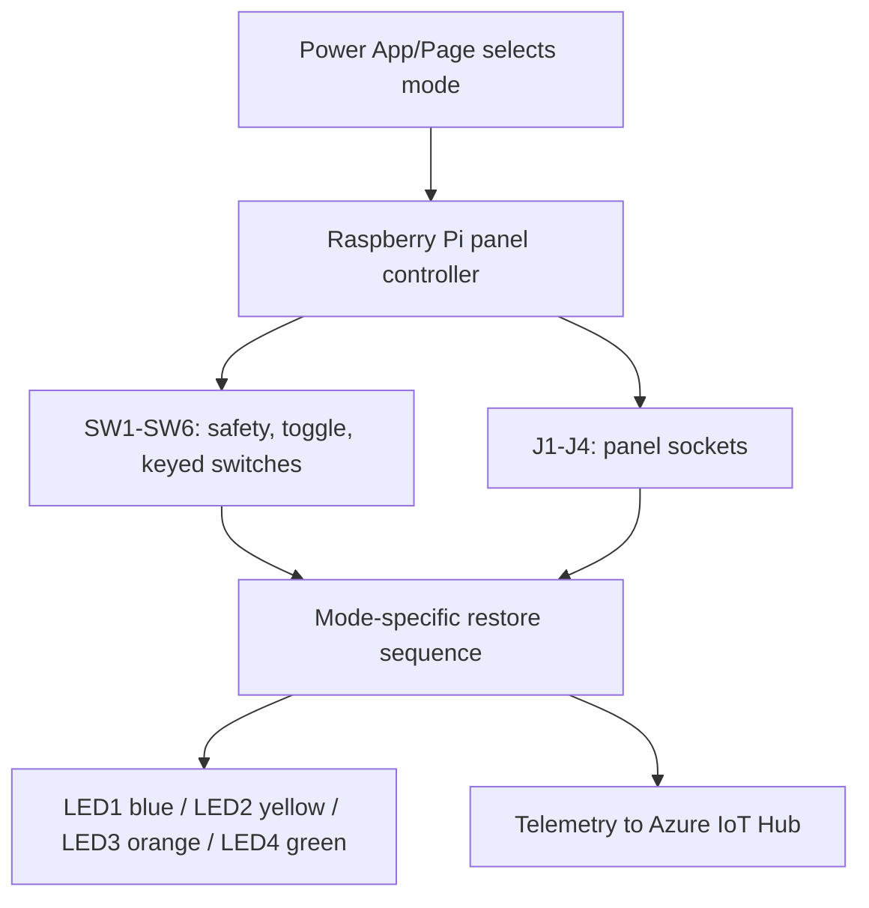

## Demo cable build reference

Use the existing cable bundle documentation below when preparing the demo cables. Cable wiring is independent of the Pi harness.

| Cable | Pinout | Contacts covered |
|---|---|---|
| Cable 1 | Side A pin 1 to Side B pin 3 Side A pin 2 to Side B pin 4 | J1 and J4 |
| Cable 2 | Side A pin 1 to Side B pin 3 Side A pin 2 to Side B pin 1 | J1 and J2 |
| Cable 3 | Side A pin 1 to Side B pin 3 Side A pin 2 to Side B pin 2 | J1 and J3 |
| Cable 4 | Side A pin 1 to Side B pin 1 Side A pin 2 to Side B pin 2 | J2 and J3 |
| Cable 5 | Side A pin 1 to Side B pin 1 Side A pin 2 to Side B pin 4 | J2 and J4 |
| Cable 6 | Side A pin 1 to Side B pin 2 Side A pin 2 to Side B pin 4 | J3 and J4 |

## Before each run

1. Select the intended mode in the Power App/Page.
2. Put each control into the opposite of the target state shown in that mode's table if you need to reset the fault condition for a new player.
3. Ask the player to follow the ordered restoration steps.
4. Confirm LED4 turns green before starting the next mode.

## Mode restore procedures

### Mode 1: Smart Thermostat

**Device slug:** `thermostat`

| Step | Control | Label | Target state | Action |
|---:|---|---|---|---|
| 1 | SW3 | Toggle switch 1 - fan running | Connected / ON | Set ON / closed |
| 2 | J1 | Socket J1 connected | Connected / ON | Plug in / connected |
| 3 | SW1 | Safety switch 1 - power | Connected / ON | Set ON / closed |
| 4 | J4 | Socket J4 connected | Open / OFF | Unplug / open |
| 5 | SW5 | Keyed switch 1 | Connected / ON | Set ON / closed |
| 6 | J2 | Socket J2 connected | Connected / ON | Plug in / connected |
| 7 | SW2 | Safety switch 2 - eco lockout | Open / OFF | Set OFF / open |
| 8 | SW6 | Keyed switch 2 | Open / OFF | Set OFF / open |
| 9 | J3 | Socket J3 connected | Open / OFF | Unplug / open |
| 10 | SW4 | Toggle switch 2 - heat/cool select | Open / OFF | Set OFF / open |

**Step diagram**

```mermaid
flowchart LR
  start([Start restoration])
  s1["1. SW3 ON"]
  start --> s1
  s2["2. J1 ON"]
  s1 --> s2
  s3["3. SW1 ON"]
  s2 --> s3
  s4["4. J4 OFF"]
  s3 --> s4
  s5["5. SW5 ON"]
  s4 --> s5
  s6["6. J2 ON"]
  s5 --> s6
  s7["7. SW2 OFF"]
  s6 --> s7
  s8["8. SW6 OFF"]
  s7 --> s8
  s9["9. J3 OFF"]
  s8 --> s9
  s10["10. SW4 OFF"]
  s9 --> s10
  done([LED4 green = restored])
  s10 --> done
```

**Success check:** Thermostat restored — holding your set temperature.

### Mode 2: Smart Lock & Security Panel

**Device slug:** `smart-lock`

| Step | Control | Label | Target state | Action |
|---:|---|---|---|---|
| 1 | J2 | Socket J2 connected | Open / OFF | Unplug / open |
| 2 | SW5 | Keyed switch 1 - service key | Connected / ON | Set ON / closed |
| 3 | SW2 | Safety switch 2 - deadbolt | Connected / ON | Set ON / closed |
| 4 | J4 | Socket J4 connected | Connected / ON | Plug in / connected |
| 5 | SW1 | Safety switch 1 - power | Connected / ON | Set ON / closed |
| 6 | SW4 | Toggle switch 2 - alarm arm | Connected / ON | Set ON / closed |
| 7 | J1 | Socket J1 connected | Open / OFF | Unplug / open |
| 8 | SW3 | Toggle switch 1 - auto-lock | Open / OFF | Set OFF / open |
| 9 | SW6 | Keyed switch 2 | Connected / ON | Set ON / closed |
| 10 | J3 | Socket J3 connected | Connected / ON | Plug in / connected |

**Step diagram**

```mermaid
flowchart LR
  start([Start restoration])
  s1["1. J2 OFF"]
  start --> s1
  s2["2. SW5 ON"]
  s1 --> s2
  s3["3. SW2 ON"]
  s2 --> s3
  s4["4. J4 ON"]
  s3 --> s4
  s5["5. SW1 ON"]
  s4 --> s5
  s6["6. SW4 ON"]
  s5 --> s6
  s7["7. J1 OFF"]
  s6 --> s7
  s8["8. SW3 OFF"]
  s7 --> s8
  s9["9. SW6 ON"]
  s8 --> s9
  s10["10. J3 ON"]
  s9 --> s10
  done([LED4 green = restored])
  s10 --> done
```

**Success check:** House is secured now.

### Mode 3: Cold-Chain Warehouse Sensor

**Device slug:** `coldchain-sensor`

| Step | Control | Label | Target state | Action |
|---:|---|---|---|---|
| 1 | SW4 | Toggle switch 2 - cloud sync | Connected / ON | Set ON / closed |
| 2 | J3 | Socket J3 connected | Connected / ON | Plug in / connected |
| 3 | SW1 | Safety switch 1 - power | Connected / ON | Set ON / closed |
| 4 | SW6 | Keyed switch 2 | Open / OFF | Set OFF / open |
| 5 | J1 | Socket J1 connected | Connected / ON | Plug in / connected |
| 6 | SW2 | Safety switch 2 - calibration | Connected / ON | Set ON / closed |
| 7 | J4 | Socket J4 connected | Open / OFF | Unplug / open |
| 8 | SW5 | Keyed switch 1 | Open / OFF | Set OFF / open |
| 9 | SW3 | Toggle switch 1 - threshold | Open / OFF | Set OFF / open |
| 10 | J2 | Socket J2 connected | Connected / ON | Plug in / connected |

**Step diagram**

```mermaid
flowchart LR
  start([Start restoration])
  s1["1. SW4 ON"]
  start --> s1
  s2["2. J3 ON"]
  s1 --> s2
  s3["3. SW1 ON"]
  s2 --> s3
  s4["4. SW6 OFF"]
  s3 --> s4
  s5["5. J1 ON"]
  s4 --> s5
  s6["6. SW2 ON"]
  s5 --> s6
  s7["7. J4 OFF"]
  s6 --> s7
  s8["8. SW5 OFF"]
  s7 --> s8
  s9["9. SW3 OFF"]
  s8 --> s9
  s10["10. J2 ON"]
  s9 --> s10
  done([LED4 green = restored])
  s10 --> done
```

**Success check:** Cold storage is stable and monitoring is back online.

### Mode 4: Water Pump Station Controller

**Device slug:** `water-pump`

| Step | Control | Label | Target state | Action |
|---:|---|---|---|---|
| 1 | J4 | Socket J4 connected | Connected / ON | Plug in / connected |
| 2 | SW2 | Safety switch 2 - pump enable | Connected / ON | Set ON / closed |
| 3 | SW5 | Keyed switch 1 | Open / OFF | Set OFF / open |
| 4 | J1 | Socket J1 connected | Open / OFF | Unplug / open |
| 5 | SW4 | Toggle switch 2 - remote override | Open / OFF | Set OFF / open |
| 6 | J2 | Socket J2 connected | Connected / ON | Plug in / connected |
| 7 | SW1 | Safety switch 1 - power | Connected / ON | Set ON / closed |
| 8 | J3 | Socket J3 connected | Open / OFF | Unplug / open |
| 9 | SW6 | Keyed switch 2 | Connected / ON | Set ON / closed |
| 10 | SW3 | Toggle switch 1 - pressure relief | Connected / ON | Set ON / closed |

**Step diagram**

```mermaid
flowchart LR
  start([Start restoration])
  s1["1. J4 ON"]
  start --> s1
  s2["2. SW2 ON"]
  s1 --> s2
  s3["3. SW5 OFF"]
  s2 --> s3
  s4["4. J1 OFF"]
  s3 --> s4
  s5["5. SW4 OFF"]
  s4 --> s5
  s6["6. J2 ON"]
  s5 --> s6
  s7["7. SW1 ON"]
  s6 --> s7
  s8["8. J3 OFF"]
  s7 --> s8
  s9["9. SW6 ON"]
  s8 --> s9
  s10["10. SW3 ON"]
  s9 --> s10
  done([LED4 green = restored])
  s10 --> done
```

**Success check:** Pump station is back online and operating normally.

### Mode 5: Tactical Field Radio

**Device slug:** `field-radio`

| Step | Control | Label | Target state | Action |
|---:|---|---|---|---|
| 1 | SW6 | Keyed switch 2 - crypto key | Connected / ON | Set ON / closed |
| 2 | J2 | Socket J2 connected | Connected / ON | Plug in / connected |
| 3 | SW3 | Toggle switch 1 - channel hop | Connected / ON | Set ON / closed |
| 4 | J1 | Socket J1 connected | Open / OFF | Unplug / open |
| 5 | SW1 | Safety switch 1 - power | Connected / ON | Set ON / closed |
| 6 | J4 | Socket J4 connected | Open / OFF | Unplug / open |
| 7 | SW2 | Safety switch 2 - encryption | Connected / ON | Set ON / closed |
| 8 | SW5 | Keyed switch 1 | Open / OFF | Set OFF / open |
| 9 | J3 | Socket J3 connected | Connected / ON | Plug in / connected |
| 10 | SW4 | Toggle switch 2 - transmit | Connected / ON | Set ON / closed |

**Step diagram**

```mermaid
flowchart LR
  start([Start restoration])
  s1["1. SW6 ON"]
  start --> s1
  s2["2. J2 ON"]
  s1 --> s2
  s3["3. SW3 ON"]
  s2 --> s3
  s4["4. J1 OFF"]
  s3 --> s4
  s5["5. SW1 ON"]
  s4 --> s5
  s6["6. J4 OFF"]
  s5 --> s6
  s7["7. SW2 ON"]
  s6 --> s7
  s8["8. SW5 OFF"]
  s7 --> s8
  s9["9. J3 ON"]
  s8 --> s9
  s10["10. SW4 ON"]
  s9 --> s10
  done([LED4 green = restored])
  s10 --> done
```

**Success check:** Secure link established with base.

### Mode 6: Smart EV Charger

**Device slug:** `ev-charger`

| Step | Control | Label | Target state | Action |
|---:|---|---|---|---|
| 1 | J3 | Socket J3 connected | Open / OFF | Unplug / open |
| 2 | SW1 | Safety switch 1 - power | Connected / ON | Set ON / closed |
| 3 | SW5 | Keyed switch 1 - service lock | Connected / ON | Set ON / closed |
| 4 | SW4 | Toggle switch 2 - billing link | Connected / ON | Set ON / closed |
| 5 | J1 | Socket J1 connected | Connected / ON | Plug in / connected |
| 6 | SW2 | Safety switch 2 - contactor | Connected / ON | Set ON / closed |
| 7 | J4 | Socket J4 connected | Connected / ON | Plug in / connected |
| 8 | SW6 | Keyed switch 2 | Open / OFF | Set OFF / open |
| 9 | SW3 | Toggle switch 1 - ground check | Connected / ON | Set ON / closed |
| 10 | J2 | Socket J2 connected | Open / OFF | Unplug / open |

**Step diagram**

```mermaid
flowchart LR
  start([Start restoration])
  s1["1. J3 OFF"]
  start --> s1
  s2["2. SW1 ON"]
  s1 --> s2
  s3["3. SW5 ON"]
  s2 --> s3
  s4["4. SW4 ON"]
  s3 --> s4
  s5["5. J1 ON"]
  s4 --> s5
  s6["6. SW2 ON"]
  s5 --> s6
  s7["7. J4 ON"]
  s6 --> s7
  s8["8. SW6 OFF"]
  s7 --> s8
  s9["9. SW3 ON"]
  s8 --> s9
  s10["10. J2 OFF"]
  s9 --> s10
  done([LED4 green = restored])
  s10 --> done
```

**Success check:** EV charger restored — charging resumed.

### Mode 7: Elevator Control Panel

**Device slug:** `elevator`

| Step | Control | Label | Target state | Action |
|---:|---|---|---|---|
| 1 | SW2 | Safety switch 2 - brake release | Connected / ON | Set ON / closed |
| 2 | J4 | Socket J4 connected | Open / OFF | Unplug / open |
| 3 | SW6 | Keyed switch 2 - inspection key | Connected / ON | Set ON / closed |
| 4 | J2 | Socket J2 connected | Connected / ON | Plug in / connected |
| 5 | SW1 | Safety switch 1 - power | Connected / ON | Set ON / closed |
| 6 | SW3 | Toggle switch 1 - doors closed | Connected / ON | Set ON / closed |
| 7 | J1 | Socket J1 connected | Connected / ON | Plug in / connected |
| 8 | SW5 | Keyed switch 1 | Open / OFF | Set OFF / open |
| 9 | J3 | Socket J3 connected | Open / OFF | Unplug / open |
| 10 | SW4 | Toggle switch 2 - inspection mode | Open / OFF | Set OFF / open |

**Step diagram**

```mermaid
flowchart LR
  start([Start restoration])
  s1["1. SW2 ON"]
  start --> s1
  s2["2. J4 OFF"]
  s1 --> s2
  s3["3. SW6 ON"]
  s2 --> s3
  s4["4. J2 ON"]
  s3 --> s4
  s5["5. SW1 ON"]
  s4 --> s5
  s6["6. SW3 ON"]
  s5 --> s6
  s7["7. J1 ON"]
  s6 --> s7
  s8["8. SW5 OFF"]
  s7 --> s8
  s9["9. J3 OFF"]
  s8 --> s9
  s10["10. SW4 OFF"]
  s9 --> s10
  done([LED4 green = restored])
  s10 --> done
```

**Success check:** Elevator back in service.

### Mode 8: Traffic Signal Controller

**Device slug:** `traffic-signal`

| Step | Control | Label | Target state | Action |
|---:|---|---|---|---|
| 1 | J1 | Socket J1 connected | Connected / ON | Plug in / connected |
| 2 | SW4 | Toggle switch 2 - manual override | Open / OFF | Set OFF / open |
| 3 | SW1 | Safety switch 1 - power | Connected / ON | Set ON / closed |
| 4 | J3 | Socket J3 connected | Connected / ON | Plug in / connected |
| 5 | SW5 | Keyed switch 1 - cabinet key | Connected / ON | Set ON / closed |
| 6 | SW2 | Safety switch 2 - controller | Connected / ON | Set ON / closed |
| 7 | J2 | Socket J2 connected | Open / OFF | Unplug / open |
| 8 | SW6 | Keyed switch 2 | Open / OFF | Set OFF / open |
| 9 | SW3 | Toggle switch 1 - timing plan | Connected / ON | Set ON / closed |
| 10 | J4 | Socket J4 connected | Connected / ON | Plug in / connected |

**Step diagram**

```mermaid
flowchart LR
  start([Start restoration])
  s1["1. J1 ON"]
  start --> s1
  s2["2. SW4 OFF"]
  s1 --> s2
  s3["3. SW1 ON"]
  s2 --> s3
  s4["4. J3 ON"]
  s3 --> s4
  s5["5. SW5 ON"]
  s4 --> s5
  s6["6. SW2 ON"]
  s5 --> s6
  s7["7. J2 OFF"]
  s6 --> s7
  s8["8. SW6 OFF"]
  s7 --> s8
  s9["9. SW3 ON"]
  s8 --> s9
  s10["10. J4 ON"]
  s9 --> s10
  done([LED4 green = restored])
  s10 --> done
```

**Success check:** Traffic signal restored to normal cycle.

### Mode 9: Hospital Patient Monitor

**Device slug:** `patient-monitor`

| Step | Control | Label | Target state | Action |
|---:|---|---|---|---|
| 1 | SW5 | Keyed switch 1 - nurse key | Connected / ON | Set ON / closed |
| 2 | J3 | Socket J3 connected | Open / OFF | Unplug / open |
| 3 | SW2 | Safety switch 2 - leads connected | Connected / ON | Set ON / closed |
| 4 | J1 | Socket J1 connected | Connected / ON | Plug in / connected |
| 5 | SW4 | Toggle switch 2 - alarm audible | Connected / ON | Set ON / closed |
| 6 | SW1 | Safety switch 1 - power | Connected / ON | Set ON / closed |
| 7 | J4 | Socket J4 connected | Open / OFF | Unplug / open |
| 8 | SW3 | Toggle switch 1 - SpO2 sensor | Connected / ON | Set ON / closed |
| 9 | SW6 | Keyed switch 2 | Open / OFF | Set OFF / open |
| 10 | J2 | Socket J2 connected | Connected / ON | Plug in / connected |

**Step diagram**

```mermaid
flowchart LR
  start([Start restoration])
  s1["1. SW5 ON"]
  start --> s1
  s2["2. J3 OFF"]
  s1 --> s2
  s3["3. SW2 ON"]
  s2 --> s3
  s4["4. J1 ON"]
  s3 --> s4
  s5["5. SW4 ON"]
  s4 --> s5
  s6["6. SW1 ON"]
  s5 --> s6
  s7["7. J4 OFF"]
  s6 --> s7
  s8["8. SW3 ON"]
  s7 --> s8
  s9["9. SW6 OFF"]
  s8 --> s9
  s10["10. J2 ON"]
  s9 --> s10
  done([LED4 green = restored])
  s10 --> done
```

**Success check:** Patient monitor restored — vitals streaming normally.

### Mode 10: Retail Payment Kiosk

**Device slug:** `retail-kiosk`

| Step | Control | Label | Target state | Action |
|---:|---|---|---|---|
| 1 | SW3 | Toggle switch 1 - card reader | Connected / ON | Set ON / closed |
| 2 | SW6 | Keyed switch 2 - cash drawer key | Connected / ON | Set ON / closed |
| 3 | J4 | Socket J4 connected | Connected / ON | Plug in / connected |
| 4 | SW1 | Safety switch 1 - power | Connected / ON | Set ON / closed |
| 5 | J2 | Socket J2 connected | Open / OFF | Unplug / open |
| 6 | SW4 | Toggle switch 2 - network | Connected / ON | Set ON / closed |
| 7 | J1 | Socket J1 connected | Open / OFF | Unplug / open |
| 8 | SW2 | Safety switch 2 - receipt printer | Connected / ON | Set ON / closed |
| 9 | J3 | Socket J3 connected | Connected / ON | Plug in / connected |
| 10 | SW5 | Keyed switch 1 | Open / OFF | Set OFF / open |

**Step diagram**

```mermaid
flowchart LR
  start([Start restoration])
  s1["1. SW3 ON"]
  start --> s1
  s2["2. SW6 ON"]
  s1 --> s2
  s3["3. J4 ON"]
  s2 --> s3
  s4["4. SW1 ON"]
  s3 --> s4
  s5["5. J2 OFF"]
  s4 --> s5
  s6["6. SW4 ON"]
  s5 --> s6
  s7["7. J1 OFF"]
  s6 --> s7
  s8["8. SW2 ON"]
  s7 --> s8
  s9["9. J3 ON"]
  s8 --> s9
  s10["10. SW5 OFF"]
  s9 --> s10
  done([LED4 green = restored])
  s10 --> done
```

**Success check:** Payment kiosk back online and processing.

### Mode 11: Drone Ground Control

**Device slug:** `drone-ground-control`

| Step | Control | Label | Target state | Action |
|---:|---|---|---|---|
| 1 | J2 | Socket J2 connected | Connected / ON | Plug in / connected |
| 2 | SW4 | Toggle switch 2 - uplink | Connected / ON | Set ON / closed |
| 3 | SW6 | Keyed switch 2 - flight key | Connected / ON | Set ON / closed |
| 4 | J1 | Socket J1 connected | Connected / ON | Plug in / connected |
| 5 | SW2 | Safety switch 2 - GPS lock | Connected / ON | Set ON / closed |
| 6 | J3 | Socket J3 connected | Open / OFF | Unplug / open |
| 7 | SW1 | Safety switch 1 - power | Connected / ON | Set ON / closed |
| 8 | SW5 | Keyed switch 1 | Open / OFF | Set OFF / open |
| 9 | J4 | Socket J4 connected | Connected / ON | Plug in / connected |
| 10 | SW3 | Toggle switch 1 - telemetry | Connected / ON | Set ON / closed |

**Step diagram**

```mermaid
flowchart LR
  start([Start restoration])
  s1["1. J2 ON"]
  start --> s1
  s2["2. SW4 ON"]
  s1 --> s2
  s3["3. SW6 ON"]
  s2 --> s3
  s4["4. J1 ON"]
  s3 --> s4
  s5["5. SW2 ON"]
  s4 --> s5
  s6["6. J3 OFF"]
  s5 --> s6
  s7["7. SW1 ON"]
  s6 --> s7
  s8["8. SW5 OFF"]
  s7 --> s8
  s9["9. J4 ON"]
  s8 --> s9
  s10["10. SW3 ON"]
  s9 --> s10
  done([LED4 green = restored])
  s10 --> done
```

**Success check:** Drone link restored — ready for flight ops.

### Mode 12: Industrial Robot Arm

**Device slug:** `industrial-robot-arm`

| Step | Control | Label | Target state | Action |
|---:|---|---|---|---|
| 1 | J4 | Socket J4 connected | Open / OFF | Unplug / open |
| 2 | SW1 | Safety switch 1 - main power | Connected / ON | Set ON / closed |
| 3 | SW6 | Keyed switch 2 - teach pendant key | Connected / ON | Set ON / closed |
| 4 | J2 | Socket J2 connected | Connected / ON | Plug in / connected |
| 5 | SW3 | Toggle switch 1 - servo enable | Connected / ON | Set ON / closed |
| 6 | J1 | Socket J1 connected | Open / OFF | Unplug / open |
| 7 | SW5 | Keyed switch 1 - cell access | Connected / ON | Set ON / closed |
| 8 | SW2 | Safety switch 2 - E-stop reset | Connected / ON | Set ON / closed |
| 9 | J3 | Socket J3 connected | Connected / ON | Plug in / connected |
| 10 | SW4 | Toggle switch 2 - guard door | Open / OFF | Set OFF / open |

**Step diagram**

```mermaid
flowchart LR
  start([Start restoration])
  s1["1. J4 OFF"]
  start --> s1
  s2["2. SW1 ON"]
  s1 --> s2
  s3["3. SW6 ON"]
  s2 --> s3
  s4["4. J2 ON"]
  s3 --> s4
  s5["5. SW3 ON"]
  s4 --> s5
  s6["6. J1 OFF"]
  s5 --> s6
  s7["7. SW5 ON"]
  s6 --> s7
  s8["8. SW2 ON"]
  s7 --> s8
  s9["9. J3 ON"]
  s8 --> s9
  s10["10. SW4 OFF"]
  s9 --> s10
  done([LED4 green = restored])
  s10 --> done
```

**Success check:** Robot cell restored — supervised automation is ready.
